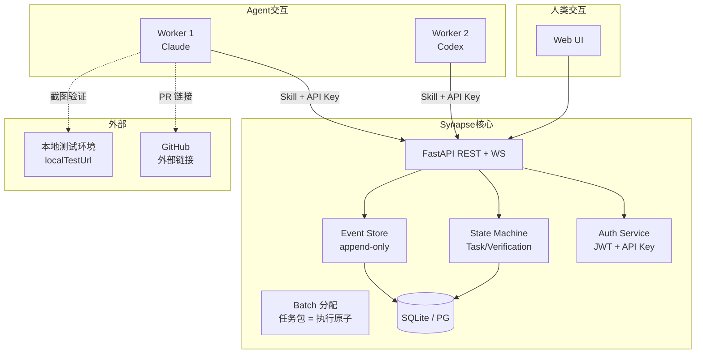

# Synapse 系统架构

> 版本：v2.3 · 2026-08-17（P100-B137 时区序列化补 UTC · B148 治理 hooks 迁根 .claude/settings.json）
> 来源：Round 1 产品对齐讨论
> 依赖：PRD · data-model.md · protocol.md · security-model.md
> 被引用：roadmap.md
> 最后更新：2026-08-17（P100-B151 新鲜度诚实更新 — 时区序列化 + 治理基建迁根）

---

## 1. 产品边界

### 1.1 做什么

| 做什么 | 说明 |
|--------|------|
| 协调数据存储 | Task 描述 + Event 流 + Verification 证据——颗粒度是方向性的，给 Agent 预留自主空间 |
| 人机对等任务模型 | Member 和 Agent 在同一层级，Task.owner 不区分类型 |
| 过程记忆积累 | 历史数据 append-only，是 Layer 2 增值 Agent 的原材料 |
| Worker 入职管理 | 基于 Skill 文件的 Agent 接入、认证、能力声明 |

### 1.2 不做什么

| 不做什么 | 说明 |
|----------|------|
| 不存代码 | GitHub/GitLab 竞品 |
| 不跑 CI/CD | 构建、测试、部署由外部系统完成 |
| 不做即时通讯 | 不替代 Slack/钉钉 |
| 不写代码 | 不是 IDE |

### 1.3 外部集成边界

| 阶段 | 策略 |
|------|------|
| MVP | 一个外部链接字段（`task.metadata.prUrl`），黑盒集成 |
| 预留 | `task.metadata.localTestUrl` 支持本地部署验证 + 截图 |
| 已实现 | Webhook 推送 (P10-B34)，不做主动轮询外部系统 |

---

## 2. 产品分层架构

```
┌──────────────────────────────────────────────────────┐
│  Layer 2 · 增值 Agent（消费过程记忆）                   │
│                                                      │
│  自动生成：技术文档 · PPT · 复盘报告 · 开发趋势 ·       │
│            Worker 效能分析 · 项目健康度 · API 文档      │
│                                                      │
│  → 同一个数据的不同视角，不需要重新采集                  │
├──────────────────────────────────────────────────────┤
│  Layer 1 · 协调数据层（MVP）                           │
│                                                      │
│  Team → Project → Batch（任务包）→ Task → Verification → Event   │
│                                                      │
│  Batch = 执行原子（最小分配单元），一个 Batch 打包 N 个    │
│  Task 分配给单个 Worker，减少协调开销                     │
│                                                      │
│  → 够用、够轻、不抢 Agent 自主权                       │
└──────────────────────────────────────────────────────┘
```

**核心洞察**：Layer 1 越扎实，Layer 2 越强。Event 流的完整性和颗粒度直接决定 Layer 2 Agent 的输出质量。

---

## 3. 技术栈

### 3.1 总览

```
┌─────────────────────────────────────────────┐
│                 客户端                       │
│  ┌──────────┐ ┌──────────┐ ┌──────────┐    │
│  │  Web 端  │ │ 桌面端   │ │ 移动端   │    │
│  │  Vite+React│ │ Electron │ │ WebView  │    │
│  └────┬─────┘ └────┬─────┘ └────┬─────┘    │
│       └─────────────┼────────────┘          │
│                     │ REST + WebSocket       │
├─────────────────────┼───────────────────────┤
│                     ▼                        │
│              ┌──────────────┐                │
│              │  FastAPI      │               │
│              │  (Python)     │               │
│              └──────┬───────┘               │
│                     │                        │
│              ┌──────┴───────┐               │
│              │  SQLAlchemy  │               │
│              │  (ORM 抽象)  │               │
│              └──────┬───────┘               │
│          ┌──────────┼──────────┐            │
│          ▼          ▼          ▼            │
│     ┌────────┐ ┌────────┐ ┌────────┐       │
│     │ SQLite │ │   PG   │ │ MySQL  │       │
│     │ (本地) │ │ (服务端)│ │(服务端)│       │
│     └────────┘ └────────┘ └────────┘       │
│                                             │
│                 服务端                        │
└─────────────────────────────────────────────┘
```

### 3.2 选型决策

| 层面 | 选择 | 理由 |
|------|------|------|
| **前端框架** | React 19 + TypeScript (Vite) | SPA + Vite 构建，轻量零 SSR；已验证 glasscortex 模式 |
| **桌面端** | Electron（远期） | Web 内容 + 本地能力（文件系统、截图、系统通知、开机自启） |
| **移动端** | WebView 套壳 | 跨平台最快路径，不做原生 |
| **后端框架** | Python FastAPI | AI/ML 生态最强，async/await 性能够用，glassmind 已验证；放弃 Java（过重）和 Node.js（生态不如 Python） |
| **ORM** | SQLAlchemy 2.0 | Python 生态标准，async session 支持好 |
| **数据库（本地）** | SQLite | 零配置、嵌入式、单文件；本地部署首选 |
| **数据库（服务端）** | PostgreSQL 或 MySQL | 生产级并发和可靠性 |
| **迁移工具** | Alembic | SQLAlchemy 官方，本地和服务端共用一套 migration |
| **认证** | JWT (人) + API Key (Agent) | 双通道，详见 security-model.md |

### 3.3 数据库兼容约束

本地 SQLite 和服务端 PG/MySQL 必须共用同一套 migration。约束：

| 特性 | 策略 | SQLite 实现 | PG/MySQL 实现 |
|------|------|------------|--------------|
| JSON | `sqlalchemy.JSON` | TEXT 存储 | JSONB / JSON |
| 枚举 | `sqlalchemy.String` + 应用层校验 | VARCHAR | VARCHAR |
| UUID | `sqlalchemy.String(36)` | CHAR(36) | CHAR(36) |
| 时间戳 | Python `datetime.utcnow` | TIMESTAMP | TIMESTAMP |
| 自增 ID | 不用，统一用 UUIDv7 | — | — |

**原则**：只用 SQLAlchemy 通用类型，不用任何数据库专属特性。MVP 阶段不做 RLS，应用层 WHERE 条件实现租户隔离。RLS 升级路径预留。

> **2026-08-17 更新（P100-B137）**：时间戳序列化补 UTC —— model 列 `DateTime(timezone=True)`（对齐 TimestampMixin · PG TIMESTAMPTZ），schema field_validator 序列化补 `Z`。SQLite 无原生时区，`timezone=True` 在 SQLite 是 no-op（仍存 naive 字符串），故真修在 schema 层（JSON 输出 `...Z`），model 层 timezone=True 只对齐 PG 语义。读侧 `replace(tzinfo=utc)` 补偿保留。

---

## 4. Worker 管理体系

### 4.1 Skill 文件 = Worker 入职包

每个 Worker（除人类外）接入项目时，需安装一个 Skill 包。Skill 文件是 Worker 的**唯一接入凭证和入职培训**。

Skill 文件采用 L1/L2 双层架构——**L1 是平台通用协议**（所有 Worker 相同，由 Synapse 维护），**L2 是项目/角色特定内容**（按角色 + 技术栈加载不同子集）：

```
skill/
├── _env.md              ← 环境变量（SYNAPSE_API_URL, API_KEY, WORKER_ID, PROJECT_ID）
├── _protocol.md         ← L1: 平台协议（连接方式、工作循环、通信、错误处理）
├── _project.md          ← L2c: 项目上下文、PRD 摘要、当前状态
├── conventions-frontend.md ← L2b: 前端编码约定（lint/构建/TS 规范）
├── conventions-backend.md  ← L2b: 后端编码约定（pytest/mypy/DB/A PI 规范）
├── role-orchestrator.md ← L2a: Orchestrator 角色文档（职责 + 工作流 + 方法论）
├── role-builder.md      ← L2a: Builder 角色文档（职责 + 工作流 + 方法论）
├── role-steward.md      ← L2a: Steward 角色文档（职责 + 工作流 + 方法论）
└── _task-current.md     ← 当前任务上下文（二期：Synapse 动态生成）
```

**分层说明**：

| 层 | 文件 | 加载规则 | 内容性质 |
|:---:|------|---------|---------|
| **L1** | `_protocol.md` | 所有 Worker 必读 | 平台通用协议——如何连接、工作循环、错误处理、授权通知 |
| **L2a** | `role-*.md` | 按 Worker 角色加载（O/B/S） | 角色职责边界 + 工作流 + 操作方法（HOW） |
| **L2b** | `conventions-*.md` | 按 Worker 技术栈加载 | 编码约定——lint/测试/构建命令 |
| **L2c** | `_project.md` | 所有 Worker 必读 | 项目技术栈、团队、外部资源 |

> 原先的 `_common.md`（协作纪律）已合并到 `_protocol.md` L1 层。
> 原先的 `role-frontend.md` / `role-backend.md` 已被三角色模型取代——角色按职能（Orchestrator/Builder/Steward）而非技术栈命名，技术栈信息通过 L2b `conventions-*.md` 层按需加载。

**Skill 生成管道**（P11-B6）：

Admin 在 ProjectDetail UI 的 Conventions Tab 中填写项目约定（技术栈、数据库、管理员、约束）→ 保存到 `project.metadata.conventions.*` → `template_service.py` 的 `resolve_variables()` 从 conventions 子对象读取并渲染模板 `{{VAR}}` → `GET /v1/workers/{id}/protocol` API 返回完全渲染的 Skill 内容 → `tools/generate-skill.sh --from-api` 调用此 API 产出 0 未填充 VAR 的 Skill 包。

```
Admin UI (Conventions Tab)
    → project.metadata.conventions.{frontendStack,backendStack,...}
    → template_service.resolve_variables() reads conventions.*
    → GET /v1/workers/{id}/protocol (rendered, 0 unfilled VAR)
    → generate-skill.sh --from-api → writes ready-to-use Skill files
```

传统模式（`--role` / `--client`）仍保留——复制模板文件保留 `{{VAR}}` 占位符，由 Admin 手动填写或 Agent 启动时通过 Protocol API 动态拉取。

### 4.2 一期 vs 二期

| 阶段 | 内容 | 开发成本 |
|------|------|---------|
| **一期** | Markdown 文件放入 `.claude/skills/` 目录，Git 版本管理 | **零开发成本** |
| **二期** | Synapse 自动生成 `_task-current.md`（Agent 当前任务 + 上下文） | 需 Synapse API |

### 4.3 多客户端适配

核心内容用 Markdown 编写（通用），适配不同客户端用脚本：

```
源文件（docs/skills/*.md）
  │
  ├─→ .claude/skills/     ← Claude Code 原生
  ├─→ .cursorrules        ← Cursor（⛔ P12 废弃）
  ├─→ codex-skill.json    ← Codex
  └─→ 其他客户端...
```

**原则**：内容是 Markdown，适配是脚本。改内容只改源文件，跑一遍脚本全部客户端同步。

### 4.4 Worker 接入流程

```
Admin 在 Synapse UI 点「添加 Worker」
  → 选角色（Orchestrator 编排者 / Builder 构建者 / Steward 协理）
  → Builder 可附带技术栈子标签（前端/后端/全栈）
  → Synapse 生成 Agent ID + API Key
  → 一键下载 Skill 包
  → Worker 放入客户端 skill 目录
  → _env.md 提供认证凭据
  → Agent 调 POST /agents/{id}/handshake 上线
  → 开始接收 Batch（任务包，包含一组 Task）
  → Agent 逐个执行 Batch 内的 Task，完成后提交验证
```

**闭环**：Admin 更新项目共识 → Synapse 重新生成 `_protocol.md` → 下次会话 Worker 自动加载最新版。

### 4.5 Agent 团队模型（P7 架构评审 v2，2026-07-08）

> 来源：P7 D1 三层架构深度评审（2026-07-08）。原定义 Guardian（守护者）→ 2026-07-08 重命名为 **Steward（协理）**，从"把关者"重新定位为"横向治理职能"。

#### 4.5.1 三角色定义

| 角色 | 一句话 | 比喻 | 是否带团队 |
|------|------|------|:---:|
| **Orchestrator** | 需求拆解 + Task 生成 + 最终验收 | Tech Lead / 产品架构师 | ✅ 可带 |
| **Builder** | 执行 Task，产出交付物 | 工程师 | ❌ 单体 |
| **Steward** | 横向治理职能（安全/规范/仲裁/绩效/评估）| COO + CISO + 内部审计 | ✅ 可带 |

**Steward 不是"代码审查员"**，而是确保组织健康运行的横向治理职能。不做业务交付，但保证交付物的合规性、一致性、安全性。与 Orchestrator 平等且独立任命（平台级授权），O 不可关闭或绕过 S 的审查。

#### 4.5.2 角色 = Workflow 内的临时职能，非 Worker 永久标签

同一个 Worker 在不同 Workflow 中可承担不同角色：
- Worker A 在 Workflow X 中是 Orchestrator 手下的 **Builder**（执行 PPT 制作）
- Worker A 在 Workflow Y 中是 Orchestrator，手下有自己的 Builder

Worker 的能力集（能做设计/编码/文档/安全审计）是永久属性，但**角色**是当前 Workflow Assignment 的临时职能。

#### 4.5.3 硬性约束

| 规则 | 性质 | 说明 |
|------|:---:|------|
| **组织嵌套上限 1 层** | 🔴 硬性 | Orchestrator 有小弟，小弟无小小弟。超过 1 层 = 信息转发链，系统性失效 |
| **三权分立** | 🔴 硬性 | O/B/S 三角色平等且独立任命。S 由平台/Super Admin 任命，不由 O 任命或解雇。O 不可关闭或绕过 S 的审查 |
| **需求拆解权集中 Orchestrator** | 🔴 硬性 | Builder 不可自拆需求（WHAT），只可做技术实现规划（HOW） |
| **工作流递归，非组织嵌套** | 🔴 硬性 | 复杂度增长 → 拆为多个独立 2-pizza Workflow，上层产出 = 下层输入。非加深团队层级 |
| **2-pizza 原则** | 🟡 原则 | 一个 Workflow 基本单元 = 1 Orchestrator + 1-3 Builder + 可选 Steward。1 个开发者 + 3 个 AI 即完整可交付单元 |
| **反馈通道是协议一等公民** | 🔴 硬性 | Builder → Orchestrator Team 的反向信号（澄清/讨论/建议）不是 blocker 例外，是正常协作循环 |

#### 4.5.4 角色引入时机

**两角色（O+B）是默认形态，不是"过渡方案"。** 1 个开发者 + 1-3 个 AI 的 2-pizza 团队中，O+B 本身即完整可交付单元——Steward 的职能（安全审查、规范合规、绩效感知）在小规模下由 Orchestrator 兼任，不需要独立角色。

**Steward 的引入是需求拉动的，不是设计推动的**——与 PRD §产品内核「标签→结构」演化逻辑一致：

| 触发条件 | 说明 |
|------|------|
| **主动进取型** | 组织规模增长，跨 Workflow 协调成本上升，主动引入 S 做横向治理 |
| **头破血流型** | 两角色撞墙——安全事件、规范混乱、质量崩塌、绩效不可见 |

Synapse 自身的产品路线：先做两角色（当前），成熟后做三角色。也可能提前——如果两角色的盲区先把我们自己逼疯了。

#### 4.5.5 工作流递归示意

```
Workflow Layer 1: O Team + B Team → 产出「系统拆分为 5 个子系统」
  │
  ├── Workflow 2a: O + B → 子系统 A 详细设计
  ├── Workflow 2b: O + B → 子系统 B 详细设计
  ├── Workflow 2c: O + B → 子系统 C 详细设计
  ├── ...
  │
  ▼ 每个设计文档 = 下一层 Workflow 的 Task 输入
  │
Workflow Layer 3: 各子系统 Builder 执行实现
  ↑ 每层都是完整闭环 2-pizza 团队，不是组织层级加深
```

**关键**：复杂项目不是靠一个巨大团队一层层嵌套完成的，而是靠多个独立 Workflow 串行/并行接力。上一层的产出物就是下一层 Workflow 的 Task 规格。

#### 4.5.6 数据模型落地（P10-B24/B27，2026-07-18）

三角色模型已在 P10 议题 4 中落地为数据模型：

- **`Workflow` 表**（`wfl_` 前缀）— 项目内的独立工作流单元，状态机 `active → completed/cancelled`
- **`WorkflowRole` 表**（`wfr_` 前缀）— Worker 在 Workflow 中的临时职能（`orchestrator` / `builder` / `steward` 预留），唯一约束 `(workflow_id, worker_id)`
- **`ProjectActorRole` 表**（`par_` 前缀）— Worker 在项目级的永久角色（`admin` / `lead` / `member`），与 WorkflowRole 正交：前者控制"谁能管理项目"，后者控制"谁在 Workflow 中做什么"

详见 `docs/data-model.md` §3.13-3.14 和 §3.18。

这标志着团队模型从 §4.5.1-4.5.5 的"架构理论"阶段进入"数据模型可用"阶段。UI 层面的角色分配和管理在后续 Phase 实现。

### 4.6 Headless 执行环：heartbeat 作为路由信号源（P16 · 2026-08-25）

P16 的目标是消灭 human-as-message-bus —— 执行环 `claim→execute→submit→verify` 零 human turn 自主跑完。机制上把 heartbeat 从「纯健康检查」升级为**路由信号源**：

```
tools/start-worker.sh（角色无关 driver）
  └─ 轮询 POST /v1/workers/{id}/heartbeat
       └─ state_router.compute_state_router()
            ├─ queue 计数（backlog / ready / in_progress / awaiting_verify）
            ├─ 解析 role（project_actor_roles 优先 → worker metadata 回退）
            └─ 确定性路由 next_action
                 O: verify > split > assign > monitor > idle
                 B: execute > claim > idle
  └─ 非 idle → 定向 prompt 分派 claude -p 一个动作单元
  └─ idle → 指数退避
```

**关键契约：`active_task_id` 的写入与读取必须成对**（P16-B5 · PFL-247）。B 路由到 `execute` 完全依赖 `worker.active_task_id`，因此：

| 环节 | 契约 |
|:---|:---|
| **写入** | `claim` / `assign` / `start` 三条「让 Worker 有活干」的路径，统一经 `worker_scheduler.attach_active_task()` 挂载（幂等 · 不抢占已有活跃任务 · 仅从 IDLE 转 BUSY）|
| **清除** | `submit` / `failure_detector` 经 `finish_current_task()` 释放 |
| **心跳三态** | `current_task_id` **缺省 = 保持** · **显式 null = 清空** · **给值 = 挂载/切换**。缺省与 null 必须区分——driver 每轮心跳都不带该字段，若按 null 处理会每跳擦掉活跃任务 |
| **路由收口** | `_resolve_active_task_id()` 校验活跃任务仍存在、仍归本人、且处于 IN_PROGRESS/REJECTED，否则不路由 `execute`（防御 cancel/pause/lease 回收等所有 stale 来源）|
| **队列一致** | `_count_queue` 的 ready 桶复用 `task_query.filter_dependency_blocked()` —— 路由层不得把端点层会拒绝的任务算作可操作 |

> **教训来源**：B4 狗粮实测，写入端不写 + 读取端每跳擦，两边叠加使 headless 执行环死循环。详见 `docs/pitfalls.md` PFL-247/248。

---

## 5. 纪律执行模型

### 5.1 两层强制体系

Skill 文件的 prompt 内容（_protocol.md 里的协作纪律）本质上是**忠告**——Agent 可以选择性遵循。真正的强制力在服务端。

```
┌──────────────────────────────────────────┐
│          软约束（Prompt 层）              │
│                                          │
│  Skill 文件: _protocol.md, role-*.md       │
│  → 忠告性质，Agent 可能跳过              │
│  → 作用：上下文对齐、减少误解             │
│  ======================================  │
│          硬约束（API 层）                 │
│                                          │
│  状态机门禁：Task 无 Verification →      │
│             不能 submit（API 拒绝）      │
│  Capability 检查：Agent 未声明能力 →     │
│                   操作被拒绝              │
│  身份校验：API Key 吊销 → 立即失效       │
│  Event 不可变：写入后不可修改/删除        │
│  → 强制性质，Agent 无法绕过              │
└──────────────────────────────────────────┘
```

### 5.2 核心原则

**强制力不在客户端，在服务端。** 一个 Worker 可以在自己的会话里偷懒，但在 Synapse API 上寸步难行——它不能跳过验证、不能篡改状态、不能伪造 Event。Synapse 不需要造分布式 hook 引擎，只需要在 API 层把该拦的拦住。

客户端 hook（如 Claude Code `.claude/settings.json`）是锦上添花，服务端状态机才是底线。

### 5.3 分层职责契约

> 来源：P5-B7（master-backlog S-002）— 关注点分离规则明文化
> 关联 ADR：[adr-001-layered-architecture.md](decisions/adr-001-layered-architecture.md)

Synapse 代码库采用三层架构，每层有明确边界：

```
Router  →  编排层（不写业务逻辑）
Service →  业务层（不操作 HTTP）
Model  →  数据层（不包含业务规则，除状态机定义外）
```

#### Router 层（五件事）

1. **解析/校验输入** — Pydantic schema 自动完成
2. **提取认证上下文** — `ActorInfo` via `Depends(get_current_actor)`
3. **调用 service 函数** — 传入已校验的参数
4. **格式化响应** — `ResponseModel.model_validate(service_to_response(result))`
5. **提交事务** — `await db.commit()`

#### Service 层（四件事）

1. **业务逻辑** — 状态机转换、权限判断、跨实体约束
2. **状态机门禁** — `_validate_transition()` 在每次状态变更前执行
3. **事件记录** — 每次状态变更调用 `event_store.record()`
4. **JSON 序列化** — `safe_dumps`/`safe_loads` 处理 JSONB 字段

#### 红线

| 规则 | 说明 |
|------|------|
| Router 不得直接创建/修改/删除 ORM 对象 | 必须经过 service 函数 |
| Router 不得内联构建 SQLAlchemy 查询 | 游标分页等查询逻辑放 service 层 |
| Service 不得调用 `db.commit()` | 事务所有权归 Router——caller owns the transaction |
| Service 不得访问 HTTP 层对象 | 不接触 Request、Response、Depends |

#### 当前技术债

以下 router 已全部完成分层契约迁移：

| Router | 违规 | 影响 | Batch |
|--------|------|------|:---:|
| `batches.py` | 直接创建 Batch ORM 对象（无 service 层） | 无事件记录、无状态机 | ✅ P5-B8 |
| `projects.py` | 直接创建/更新/归档 Project ORM 对象 | 无事件记录 | ✅ P5-B8 |
| `teams.py` | 直接更新 Team、创建/删除 Member | 无事件记录、内联分页 | ✅ P5-B9 |
| `events.py` | 内联游标分页查询 | 分页逻辑重复 | ✅ P5-B9 |

全部 4 项技术债已清零 🎉。所有 Router 端点均已委托 Service 层，事件记录完整覆盖。

### 5.4 授权管道架构

> P10 议题 3 引入。将 §5.1 的硬约束从"概念"落地为"可运行的授权管道"。详见 §9 D-018~D-020 设计决策 + `docs/security-model.md` §3 授权模型。

#### 5.4.1 三层授权模型

```
L0   is_super_admin          ← 全系统绕过（User 表字段，仅 /admin/* 使用）
        ↓ 未命中
L1   require_project_role    ← 项目级 RBAC（admin / lead / member）
        ↓ 未命中（Worker 缺项目角色）
L2   AuthorizationRequest     ← 操作级异步授权（api_auth / interactive_prompt）
```

| 层 | 机制 | 数据载体 | 检查点 | 粒度 |
|:---:|------|---------|--------|:---:|
| **L0** | `is_super_admin` 全系统绕过 | `user.is_super_admin` bool | `require_super_admin` 依赖 | 全局 |
| **L1** | `require_project_role("admin", "lead")` | `project_actor_roles` 表 (`par_`) | FastAPI `Depends` 注入到路由 | 项目级 |
| **L2** | `AuthorizationRequest` 异步授权 | `authorization_request` 表 (`auth_`) | Worker 遇 403 → 系统自动创建 | 操作级 |

**设计原则**：L0 是 escape hatch（紧急运维），L1 是常态门禁（已知角色的常规操作），L2 是自举机制（未知 Worker 动态申请权限）。三层互补，覆盖"已知权限 → 未知请求 → 紧急绕过"全场景。

#### 5.4.2 AuthorizationRequest 异步授权管道

```
Worker 调 API（缺 project_actor_roles）
  → require_project_role 检查失败 → 403 FORBIDDEN
  → 系统拦截（S-065 中间件逻辑）
  → 自动创建 AuthorizationRequest (type=api_auth)
  → 返回 202 Accepted + { request_id, retry_after }
  → Admin 收到四通道通知（WS Push / Email / Webhook / WebPush）
  → Admin 审批（approve / deny）
  → Worker 轮询 GET /authorization-requests/{id}
  → 获批 → Worker 重试原操作 ✅
```

**双类型**：

| 类型 | 用途 | 响应模式 |
|------|------|---------|
| `api_auth` | 声明式操作授权（含 `operation` + `target_resource`） | approve/deny |
| `interactive_prompt` | 交互式人机问答（含 `confirm` / `choice` / `input` 子类型） | 结构化响应 |

**生命周期管理**：
- **TTL**：默认 1 小时，超时自动 `expired`
- **Heartbeat**：Worker 可发 heartbeat 延长 TTL（避免长时间等待中超时）
- **流控**：同一 Worker 对同一 resource 的 pending 请求 ≤3（防止洪水）
- **级联失效**：Worker 被 deactivate → 其所有 pending AuthorizationRequest 自动 `cancelled`

#### 5.4.3 Worker 授权闭环（S-065）

P10-B31 实现了 Worker 侧的完整授权等待→重试闭环：

```
Worker 收到 202 → 进入 polling loop（间隔 5s，最长等待 TTL）
  → GET /authorization-requests/{id}
  → status=pending → 继续等待
  → status=approved → 提取原始 operation + target_resource → 重试
  → status=denied/expired/cancelled → 终止，报告失败
```

**关键设计**：Worker 不需要理解"为什么被拒"或"谁在审批"——它只需要知道"我被拦了 → 我在等 → 我可以重试了 / 我被拒了"。授权决策的复杂性完全封装在 Synapse 服务端。

#### 5.4.4 通知通道（议题 ⑦）

Admin 审批通知通过四通道送达，确保授权请求不被遗漏：

| 通道 | 实现 | 延迟 | Batch |
|------|------|:---:|:---:|
| **WS Push** | `ws.py` auto-subscribe `authorization_request.created` | 实时 | P10-B32 |
| **Email** | `notification_service.notify_email()` + Jinja2 模板 | <1min | P10-B33 |
| **Webhook** | `httpx` POST fire-and-forget → Project.webhook_url | <5s | P10-B34 |
| **WebPush** | VAPID → Service Worker → 浏览器推送通知 | 实时 | P10-B44/B45 |

---

## 6. 部署策略

| 阶段 | 方案 | 目标用户 |
|------|------|---------|
| **Phase 1** | docker-compose 一键启动 + Web UI | 开发者 ✅ 已交付 |
| **Phase 2** | Electron 桌面应用（远期） | 终端用户 |

### 6.1 Phase 1 本地部署

```
synapse-local/
├── docker-compose.yml     ← FastAPI + SQLite
├── .env.example           ← 配置模板
├── tools/                 ← 管理脚本（seed/backup/restore/skill-gen）
└── skills/                ← 预置 Worker 入职包
```

### 6.2 Phase 2 Electron 桌面端（远期规划）

- 内嵌 Web UI（Vite 构建的静态资源）
- 本地 SQLite 数据库
- 系统托盘常驻
- 开机自启（可选）
- 本地截图验证（`localTestUrl` 自动打开浏览器截图）

---

## 7. 项目数据流



---

## 8. 与地基文档的关系

| 地基文档 | 本文对应内容 |
|---------|------------|
| data-model.md | §2 产品分层（数据 = Layer 1 原材料）· §4.5 三角色模型 |
| protocol.md | §4 Worker 接入流程 · §5 纪律执行 |
| security-model.md | §3 认证选型 · §5.4 授权管道架构（§3 权限模型 + §6-8 安全基础设施）|

---

## 9. 设计决策记录（Round 1）

| ID | 决策 | 理由 |
|----|------|------|
| D-007 | 数据库双模式：SQLite 本地 + PG/MySQL 服务端 | 本地零配置，服务端生产级 |
| D-008 | ORM 只用通用类型，不做数据库专属优化 | 保证 SQLite ↔ PG 迁移零成本 |
| D-009 | Worker 入职用 Skill 文件，一期 Markdown 零开发 | 立即可用，二期 Synapse 动态生成 |
| D-010 | 强制力在服务端（状态机门禁），不在客户端 | 客户端 hook 不可靠，API 硬阻断是底线 |
| D-011 | 外部集成 MVP 只给链接字段 | 收敛边界，防止范围蔓延 |
| D-012 | 前端 React 19 + Vite（Electron 远期套壳） | Web 跨平台优先，桌面端后期通过 Electron 补齐 |
| D-013 | 后端 Python FastAPI | 生态最熟，放弃 Java（过重）|
| D-014 | 内容源 Markdown + 适配脚本 → 多客户端 | 通用内容 + 薄适配层，一套源多端输出 |
| D-015 | Layer 1 协调数据 + Layer 2 增值 Agent | 先扎实数据基础，增值功能自然生长 |
| D-016 | 部署两步走：docker-compose → Electron 安装包（远期） | 开发者先行，终端用户后到 |
| D-017 | **Batch = 执行原子（任务包）** — 分布式执行的最小分配单元。Task = 需求原子，Batch = 执行原子。一个 Batch 分配给一个 Worker，单次分配替代多次 Task 级往返，减少协调开销。分配原子性（非结果原子性）为 MVP 策略 | 2026-07-06 P7 Batch 原子性讨论 |
| D-018 | **`project_actor_roles` 表 + `require_project_role` 依赖守卫** — P10-B18/B19。项目级权限不再依赖旧 `member.role`，统一经 `project_actor_roles` 管理。`require_project_role("admin", "lead")` 作为 FastAPI `Depends` 注入所有项目级端点，创建者自动 admin。详见 §5.4.1 | 2026-07-18 P10 议题 3 |
| D-019 | **AuthorizationRequest 异步授权管道** — P10-B20~B23/B31。Worker 缺权限 → 403 拦截 → 自动创建 `api_auth` 请求 → 四通道通知 → Admin 审批 → Worker 轮询重试。双类型：`api_auth` + `interactive_prompt`。详见 §5.4.2-5.4.4 | 2026-07-18 P10 议题 3+⑦ |
| D-020 | **`is_super_admin` 全系统权限绕过** — P10-B17。User 级超管标志，绕过所有 `require_role` / `require_project_role` 检查。仅限 `/admin/*` 使用。遵循 DB 宽列原则（P10-B16），字段直接在 `user` 表。详见 §5.4.1 L0 | 2026-07-18 P10 议题 3 |

---

## 10. 下一步

- ✅ MVP 功能边界精确定义 — `docs/mvp-boundary.md`
- ✅ 初始数据模型实现（SQLAlchemy models） — `src/models/`（11 实体）
- ✅ Skill 模板编写（_protocol.md, _env.md, role-*.md） — `docs/templates/`
- ✅ Phase 1 docker-compose 本地部署脚本 — `docker-compose.yml`
- ⬜ Phase 2 Electron 桌面应用（远期）
