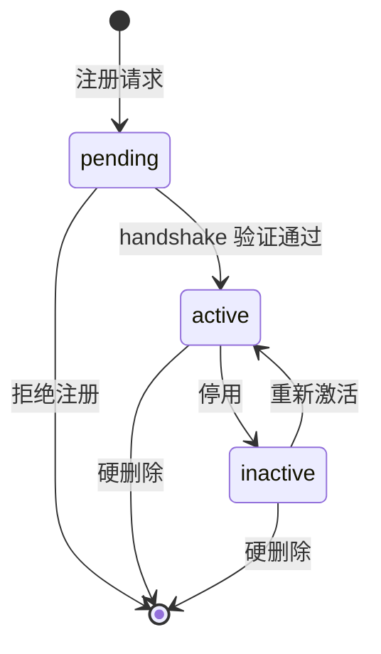
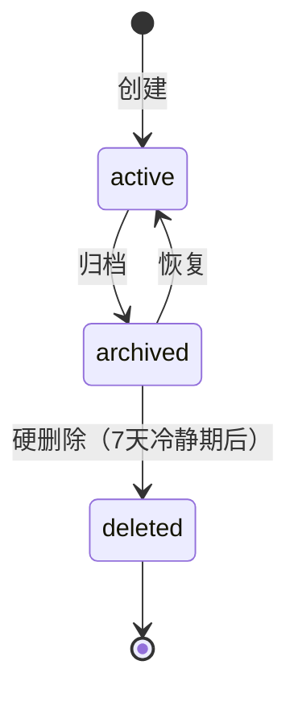
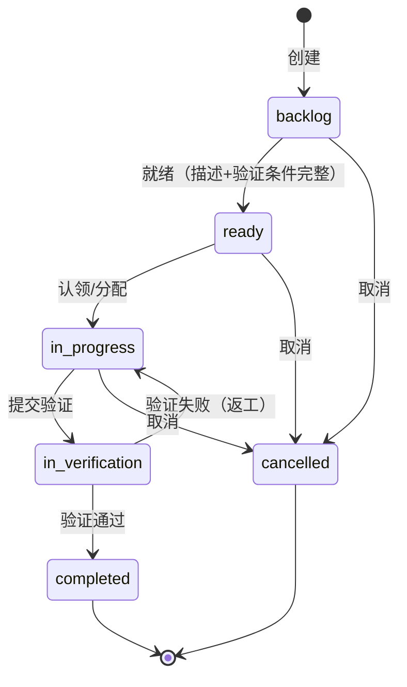
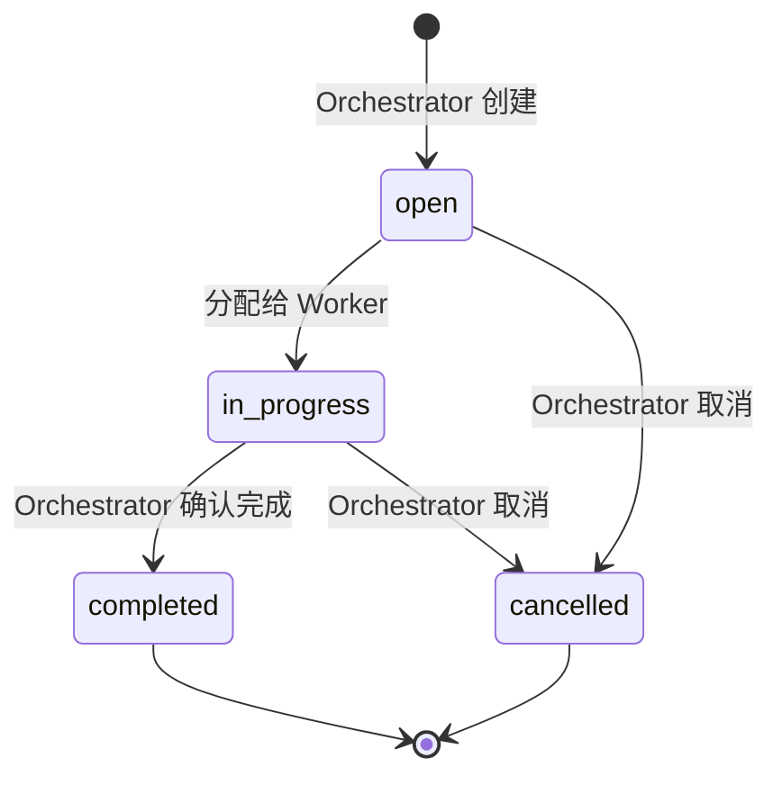
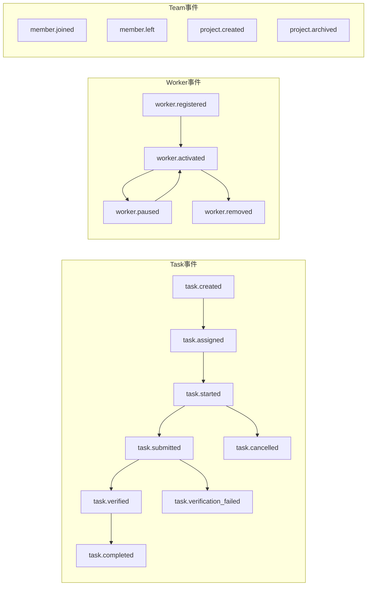

# Synapse 核心数据模型 — 实体定义

> 版本：与 [`data-model.md`](data-model.md) 同步 · 2026-07-18（P100-B74 拆分 · P100-B78 补齐议题⑤⑥实体 — §3.20-3.23 新增 · 19→23 实体 · P100-B83 补齐 ScanResult — §3.24 新增 · 23→24 实体）
> 父文档：[`data-model.md`](data-model.md) — 设计原则 · ER 总览 · 关系矩阵 · Actor 统一抽象 · 查询模式 · JSONB 扩展策略 · ID 设计 · 设计决策记录
> 被引用：protocol.md · security-model.md · architecture.md

---

## 3. 实体定义

### 3.1 Team（团队）

租户边界。一个 Team 内的所有数据对其他 Team 完全不可见。

| 属性 | 类型 | 约束 | 说明 |
|------|------|------|------|
| `id` | UUIDv7 | PK | 全局唯一 |
| `name` | string(100) | NOT NULL, UNIQUE(slug) | 显示名 |
| `slug` | string(100) | NOT NULL, UNIQUE, `^[a-z0-9-]+$` | URL 标识 |
| `description` | string(2000) | | 团队简介 |
| `avatarUrl` | string(2048) | | 头像 URL |
| `createdAt` | timestamp | NOT NULL, IMMUTABLE | 创建时间 |
| `updatedAt` | timestamp | NOT NULL | 最后修改 |

**状态**：Team 本身无状态机，通过 `archivedAt` 软删除。

**约束**：
- Slug 创建后不可修改
- 删除 Team 前必须无活跃 Project

---

### 3.2 Member（人类成员）

一个人类用户在一个 Team 中的身份。同一个人类可以在多个 Team 中有不同身份。

| 属性 | 类型 | 约束 | 说明 |
|------|------|------|------|
| `id` | UUIDv7 | PK | 全局唯一 |
| `teamId` | UUIDv7 | FK → Team, NOT NULL | 所属团队 |
| `userId` | UUIDv7 | NOT NULL | 指向外部 Auth 系统的用户 ID |
| `displayName` | string(100) | NOT NULL | 显示名 |
| `role` | enum | NOT NULL | `admin` \| `lead` \| `member` |
| `joinedAt` | timestamp | NOT NULL, IMMUTABLE | 加入时间 |
| `lastActiveAt` | timestamp | | 最后活跃时间 |

**角色定义**（详见 security-model.md）：
| 角色 | 权限摘要 |
|------|---------|
| `admin` | 管理 Team 设置、成员、Worker 注册 |
| `lead` | 管理 Project、分配 Task、审批 Verification |
| `member` | 创建/认领 Task、更新状态、查看所有内容 |

**约束**：
- `(teamId, userId)` UNIQUE — 同一人在同一 Team 只能有一个 Member 记录
- 每个 Team 至少一个 `admin`

---

### 3.3 Worker（AI/人类工作者）

一个 Worker 在一个 Team 中的注册身份。Worker 由 Member 注册和管理。可以是 AI Worker 或人类。

| 属性 | 类型 | 约束 | 说明 |
|------|------|------|------|
| `id` | UUIDv7 | PK | 全局唯一 |
| `team_id` | UUIDv7 | FK → Team, NOT NULL | 所属团队 |
| `name` | string(100) | NOT NULL | 显示名（如 "Claude-Architect"） |
| `provider` | enum | NOT NULL | `claude` \| `codex` \| `custom` |
| `provider_model` | string(100) | | 模型标识（如 "claude-opus-4-8"） |
| `registered_by` | UUIDv7 | FK → Worker, NULLABLE | 注册者（指向人类 Worker；系统自建为 NULL） |
| `api_key_hash` | string(255) | NOT NULL, HASHED | API Key 哈希值 |
| `api_key_prefix` | string(8) | | API Key 前缀（用于 UI 显示） |
| `status` | enum | NOT NULL | `pending` \| `active` \| `inactive` |
| `system_prompt` | text | | 系统级 prompt 模板 |
| `batch_size` | int | NOT NULL, default 3 | Worker 适合处理的最大 Batch 任务数（对齐人脑并行追踪上限） |
| `metadata_` | JSONB | | 扩展元数据（速率限制、超时等），列别名 `metadata` |
| `created_at` | timestamp | NOT NULL, IMMUTABLE | 注册时间 |
| `updated_at` | timestamp | NOT NULL | 最后修改 |

**状态机**：


**约束**：
- `(team_id, name)` UNIQUE — 同一 Team 内 Worker 名唯一
- `registered_by` 的 Worker 必须存在且属于同一 Team（NULL 表示系统自建）
- `api_key_hash` 写入后不可明文读取（仅 Worker 自身在运行时解密）

---

### 3.4 Capability（Worker 能力声明）

Worker 必须显式声明自己能做什么。未声明的能力不可执行。

| 属性 | 类型 | 约束 | 说明 |
|------|------|------|------|
| `id` | UUIDv7 | PK | |
| `worker_id` | UUIDv7 | FK → Worker, NOT NULL | 所属 Worker |
| `name` | string(100) | NOT NULL | 能力名（如 "code-review"） |
| `description` | string(500) | | 能力描述 |
| `inputSchema` | JSONB | | 输入参数 JSON Schema |
| `outputSchema` | JSONB | | 输出参数 JSON Schema |
| `rateLimit` | JSONB | | `{maxPerMin, maxPerHour}` |

**内置能力类型**：
| 能力 | 说明 |
|------|------|
| `task.create` | 创建新 Task |
| `task.update` | 更新 Task 状态/内容 |
| `task.read` | 读取 Task 列表和详情 |
| `code.review` | 审查代码变更 |
| `code.generate` | 生成代码 |
| `docs.write` | 写文档 |
| `test.run` | 运行测试 |
| `deploy.trigger` | 触发部署 |

---

### 3.5 Project（项目空间）

一个软件项目的协调空间。包含 Task 和 Batch。

| 属性 | 类型 | 约束 | 说明 |
|------|------|------|------|
| `id` | UUIDv7 | PK | |
| `teamId` | UUIDv7 | FK → Team, NOT NULL | 所属团队 |
| `name` | string(200) | NOT NULL | 项目名 |
| `slug` | string(200) | NOT NULL, UNIQUE(teamId+slug) | URL 标识 |
| `description` | text | | 项目描述 |
| `status` | enum | NOT NULL | `active` \| `archived` \| `deleted` |
| `defaultBranch` | string(200) | | 关联 Git 默认分支 |
| `gitRepoUrl` | string(2048) | | 关联 Git 仓库 URL（可选） |
| `apiDocsUrl` | string(2048)? | | API 文档 URL（P7-001） |
| `frontendTestUrl` | string(2048)? | | 前端测试 URL（P7-001） |
| `organization` | string(200)? | | 所属组织（P7-001） |
| `isProtected` | bool | DEFAULT false | 防误删保护标记 — 受保护项目不可归档/删除（P7-004） |
| `archivedAt` | timestamp? | | 归档时间 — 硬删除时用于计算 7 天冷静期（P7-004） |
| `webhookUrl` | string(2048)? | | Per-project webhook URL for event notifications（P10-B34） |
| `usePhaseMode` | bool | DEFAULT false | Phase/Sprint 二级编号模式开关（P10-B40） |
| `currentPhase` | string(200)? | | 当前 Phase 名称/目标声明（P10-B40） |
| `metadata` | JSONB | | 扩展配置 |
| `createdAt` | timestamp | NOT NULL, IMMUTABLE | |
| `updatedAt` | timestamp | NOT NULL | |

**状态机**：


---

### 3.6 Task（任务）

最小工作单元。**owner 可以是 Member 也可以是 Worker**——这是人机对等的核心体现。

| 属性 | 类型 | 约束 | 说明 |
|------|------|------|------|
| `id` | UUIDv7 | PK | |
| `projectId` | UUIDv7 | FK → Project, NOT NULL | 所属项目 |
| `title` | string(500) | NOT NULL | 任务标题 |
| `description` | text | | 任务描述（支持 Markdown） |
| `ownerType` | enum | NOT NULL | `member` \| `agent` |
| `ownerId` | UUIDv7 | NOT NULL | 指向 Member.id 或 Worker.id |
| `status` | enum | NOT NULL | 见状态机 |
| `priority` | enum | DEFAULT `p2` | `p0` \| `p1` \| `p2` \| `p3` |
| `parentTaskId` | UUIDv7? | FK → Task | 父任务（子任务层级） |
| `batchId` | UUIDv7? | FK → Batch | 所属任务包 |
| `estimatedEffort` | enum? | | `xs`(<1h) \| `s`(1-4h) \| `m`(1d) \| `l`(2-3d) \| `xl`(1w+) |
| `tags` | string[] | | 标签列表 |
| `metadata` | JSONB | | 扩展（外部链接、关联 PR 等） |
| `deadlineAt` | timestamp? | | 截止时间 |
| `createdAt` | timestamp | NOT NULL, IMMUTABLE | |
| `updatedAt` | timestamp | NOT NULL | |
| `completedAt` | timestamp? | | 完成时间 |

**状态机**：


**状态转移守卫**：
| 转移 | 前置条件 |
|------|---------|
| `backlog → ready` | Task 描述非空 + 至少 1 条 Verification |
| `ready → in_progress` | owner 已分配 |
| `in_progress → in_verification` | owner 提交验证请求 |
| `in_verification → completed` | 所有 Verification 通过 |
| `in_verification → in_progress` | 任一 Verification 失败 |

**约束**：
- `(ownerType, ownerId)` 必须指向存在的 Member 或 Agent
- 若 `ownerType = agent`，Worker 必须声明了执行此 Task 所需的 Capability
- 子任务（`parentTaskId != null`）的 owner 可以与父任务不同
- `batchId` 指向的 Batch 必须属于同一 Project

---

### 3.7 Batch（任务包）

**分布式执行中的最小分配单元（执行原子）。** 一个 Batch 包含一组相关 Task，作为一个整体分配给单个 Worker 执行。

#### 为什么需要 Batch？

单个 Worker 单次只处理一个 Task → 频繁的 assign/complete 往返 → 每个往返都是一次上下文切换 + 通信开销。Batch 把 N 次分配压缩成 1 次，直接减少系统中的协调开销。

**核心逻辑链**：
- **Task = 需求原子**（定义层）— 再拆下去，协作成本 > 生产成本
- **Batch = 执行原子**（执行层）— 如果还能拆，在分布式场景下就失去了减少协调开销的意义
- **一个 Worker 同一时间只处理一个 Batch**，但一个 Batch 可包含多个 Task

#### 属性

| 属性 | 类型 | 约束 | 说明 |
|------|------|------|------|
| `id` | UUIDv7 | PK | |
| `projectId` | UUIDv7 | FK → Project, NOT NULL | 所属项目 |
| `name` | string(200) | NOT NULL | 任务包名（如 "P7-B1 数据模型刷新"） |
| `description` | text | | 本批要达成的目标 |
| `status` | enum | NOT NULL | `open` \| `in_progress` \| `completed` \| `cancelled` |
| `order` | int | | 排序索引 |
| `phase` | string(10) | | 结构化 Phase 编号（如 "P9"） |
| `batchNumber` | int | | Batch 序号（如 57） |
| `assignedTo` | UUIDv7 | FK → Worker, nullable | 分配给的 Worker — 一个 Batch 同一时间只分配给一个 Worker |
| `createdAt` | timestamp | NOT NULL, IMMUTABLE | |
| `updatedAt` | timestamp | NOT NULL | |
| `completedAt` | timestamp? | | |

> **P9-B57 落地**：`assignedTo` 字段已从"远期"升级为显式 FK。分配原子性（一个 Batch 同一时间只分配给一个 Worker）已通过模型约束落地。参见下文分配原子性约束。

#### 状态机



**状态转移说明**：

| 转移 | 触发者 | 含义 |
|------|:---:|------|
| `open → in_progress` | Orchestrator | 将 Batch 分配给一个 Worker 开始执行 |
| `in_progress → completed` | Orchestrator | 确认 Batch 目标达成，手动标记完成 |
| `open → cancelled` | Orchestrator | 分配前取消（需求变更、优先级调整等） |
| `in_progress → cancelled` | Orchestrator | 执行中取消（Worker 不可用、方向调整等） |

#### 分配原子性约束（MVP）

1. **一个 Batch 同一时间只分配给一个 Worker** — 不会同时分配给两个 Worker
2. **Batch 不可拆分执行** — 分配给 Worker 后，Worker 负责 Batch 内所有 Task
3. **取消由 Orchestrator 判定** — Worker 不能单方面取消已分配的 Batch；遇到阻塞时通过评论申请取消
4. **部分失败不自动回滚** — 若 Batch 内部分 Task 失败，由 Orchestrator 人工逐 Task 判定处理方式（重新分配 / 取消 / 接受部分完成）。系统不做级联取消或自动回滚

> **远期升级**：当 AI 幻觉率显著下降 + 团队规模扩大 → 升级为**结果原子**（Batch completed ⇔ 所有子 Task completed），引入 `partially_completed` 状态和自动回滚机制。详见 P7-007。

#### 粒度（Batch Size）

Batch 包含多少个 Task **不是固定常数**，取决于 Worker 的消化能力：

| 阶段 | 方式 | 说明 |
|:---|------|------|
| **MVP** ✅ | Orchestrator 人工设定，默认 3 | `Worker.batch_size` 显式列（P9-B57 从 metadata 升级为独立列），Worker 注册时设定 |
| **远期** | Worker 能力函数 | 系统根据历史吞吐量、完成率动态调整配额 |

> 默认值 3 的依据：对齐人脑并行追踪上限（3-4），不是机器并发极限。Worker 硬件能力是上限约束，不是目标值。详见 P7-008。

#### 与 Task 的关系

- `Task.batchId` → `Batch.id`：可选外键。一个 Task 可独立存在（未分配），也可归属到一个 Batch
- 一个 Batch 创建时绑定一组 Task，执行期间 Task 列表**不建议动态增减**（MVP 不强制门禁，但变更会破坏执行上下文的完整性）
- Batch 的 `completed` 不要求所有子 Task 都 `completed`——由 Orchestrator 人工判定（MVP 简化策略）

---

### 3.8 Verification（验证条件）

Task 完成必须满足的条件。**创建时即定义，不可后补。**

| 属性 | 类型 | 约束 | 说明 |
|------|------|------|------|
| `id` | UUIDv7 | PK | |
| `taskId` | UUIDv7 | FK → Task, NOT NULL | 所属 Task |
| `type` | enum | NOT NULL | `manual` \| `automated` \| `check_list` |
| `description` | string(1000) | NOT NULL | 验证条件描述 |
| `criteria` | JSONB | | 结构化条件（自动验证的规则） |
| `status` | enum | NOT NULL, DEFAULT `pending` | `pending` \| `passed` \| `failed` |
| `verifiedBy` | UUIDv7? | | 验证者 Member.id |
| `verifiedAt` | timestamp? | | 验证时间 |
| `evidence` | JSONB? | | 验证证据（链接、截图、日志） |
| `createdAt` | timestamp | NOT NULL, IMMUTABLE | |

**验证类型**：
| 类型 | 说明 | 示例 |
|------|------|------|
| `manual` | 人工审查 | "Team Lead 审查代码变更" |
| `automated` | Worker 自动检查 | "所有 CI 检查通过" |
| `check_list` | 检查项列表 | "□ 单元测试通过 □ lint 无报错 □ 文档已更新" |

**约束**：
- Task 进入 `in_verification` 前至少 1 条 Verification
- Task 状态为 `completed` → 所有 Verification 必须 `passed`
- `verifiedBy` 为 NULL 且 `type = manual` → 不可标记为 `passed`

---

### 3.9 Event（事件）

所有状态变更的不可变记录。**Synapse 的"账本"——一切状态都是 Event 的折叠投影。**

| 属性 | 类型 | 约束 | 说明 |
|------|------|------|------|
| `id` | UUIDv7 | PK, IMMUTABLE | |
| `teamId` | UUIDv7 | FK → Team, NOT NULL | 租户边界 |
| `eventType` | string(100) | NOT NULL | 事件类型（见下表） |
| `actorType` | enum | NOT NULL | `member` \| `agent` \| `system` |
| `actorId` | UUIDv7 | NOT NULL | 触发者 ID |
| `targetType` | string(50) | NOT NULL | 目标实体类型 |
| `targetId` | UUIDv7 | NOT NULL | 目标实体 ID |
| `payload` | JSONB | NOT NULL | 事件载荷（变更前后状态） |
| `idempotencyKey` | string(255)? | UNIQUE | 幂等键（防重复） |
| `createdAt` | timestamp | NOT NULL, IMMUTABLE | 事件发生时间 |

**完整事件模型**（标注 ✅ 的为 MVP 已实现，其余为计划中）:


**Payload 规范**：
```json
// 示例：task.assigned
{
  "eventType": "task.assigned",
  "changes": {
    "ownerType": {"from": null, "to": "agent"},
    "ownerId": {"from": null, "to": "ag_7a3b..."},
    "status": {"from": "ready", "to": "in_progress"}
  },
  "snapshot": {
    "taskId": "tsk_9f2c...",
    "title": "实现用户登录 API"
  }
}
```

**约束**：
- Event 创建后不可修改、不可删除
- `idempotencyKey` 全局唯一，重复提交返回已有 Event（幂等）
- `payload.changes` 只记录实际变更的字段

### 3.10 AnalysisRecord（分析记录）🆕 P6-B20

不可变分析账本。Worker 在动手前提交结构化分析，记录"谁、在哪个项目、做了什么分析"。

| 属性 | 类型 | 约束 | 说明 |
|------|------|------|------|
| `id` | str(40) | PK, `anl_` 前缀 | 全局唯一 |
| `project_id` | str(40) | FK → Project, NOT NULL | 所属项目 |
| `actor_type` | str(20) | NOT NULL | `"member"` \| `"agent"` |
| `actor_id` | str(40) | NOT NULL | 分析者 ID |
| `analysis_type` | str(30) | NOT NULL | `requirement` \| `discussion` \| `design`（预留 6 种） |
| `title` | str(500) | NOT NULL | 分析标题 |
| `content` | text | NOT NULL | Markdown 正文 |
| `source_batch_id` | str(40)? | FK → Batch | 产出任务包（追溯） |
| `metadata` | str(4000)? | JSON | 扩展位 |
| `created_at` | timestamp | NOT NULL | 创建时间 |
| `updated_at` | timestamp | NOT NULL | 最后修改 |

**设计决策**：
- **不可变**：创建后不提供编辑/删除 — 分析即账本
- **无状态机**：纯事实记录，不需要 lifecycle
- **Actor 可溯源**：`actor_type + actor_id` 精确追踪
- **宽数据 + 薄实现**：`analysis_type` 预留 6 种，首版只实现 3 种（`requirement` \| `discussion` \| `design`）

**API 端点**（P6-B21）：
- `POST /v1/projects/{pid}/analyses` — 创建分析
- `GET /v1/projects/{pid}/analyses?type=&cursor=&limit=` — 分页列表
- `GET /v1/analyses/{id}` — 详情（team-scoped）

### 3.11 TokenUsage（Token 消耗记录）🆕 P9-B50

Worker LLM 调用的 token 消耗不可变记录。**消耗维度的"账本" — 只增不删不改。**

| 属性 | 类型 | 约束 | 说明 |
|------|------|------|------|
| `id` | str(40) | PK, `tku_` 前缀 | 全局唯一 |
| `worker_id` | str(40) | FK → Worker, NOT NULL | 消耗归属 |
| `task_id` | str(40)? | FK → Task | 关联任务（可选） |
| `project_id` | str(40)? | FK → Project | 关联项目（可选） |
| `provider` | str(30) | NOT NULL | LLM 提供商（anthropic/openai/…） |
| `model` | str(100) | NOT NULL | 模型名（claude-opus-4-7/…） |
| `prompt_tokens` | bigint | NOT NULL, ≥0 | 输入 token 数 |
| `completion_tokens` | bigint | NOT NULL, ≥0 | 输出 token 数 |
| `cost` | str(30)? | — | 成本（预埋，暂不暴露） |
| `request_id` | str(255)? | — | 外部请求 ID（去重/关联） |
| `recorded_at` | timestamp | NOT NULL | 记录时间 |
| `metadata` | str(4000)? | JSON | 扩展位 |

**API 端点**:
- `POST /v1/workers/{id}/token-usage` — 上报消耗（Worker 自报或 Human 代报）
- `GET /v1/workers/{id}/token-usage?cursor=&limit=` — 游标分页查询

**设计约束**: Worker 只能报自己的消耗（`actor.actor_type == "agent"` → `actor_id == agent_id`）；Human member 无此限制。total_tokens 是计算字段（= prompt + completion），不存 DB。

---

### 3.12 AuthorizationRequest（授权请求）🆕 P10-B20/B22

议题 3（异步授权管道）的核心实体。双类型单表设计：同一张表容纳两种不同的授权场景。

#### 类型鉴别

| request_type | 场景 | 触发器 | 解析方式 |
|:---|------|------|------|
| `api_auth` | Worker 操作被 403 → 需人类审批后系统代执行 | 系统自动创建 | 人类 approve/deny → 系统重放操作 |
| `interactive_prompt` | 系统需人类输入（确认/选择/文本） | 系统或人类创建 | 人类 respond → 系统读取 response_data |

#### 属性

| 字段 | 类型 | 必填 | 说明 |
|------|------|:--:|------|
| id | STR(40) | ✅ | `areq_` 前缀 UUIDv7 |
| project_id | FK→project | ✅ | 所属 Project |
| worker_id | FK→worker | ✅ | 发起请求的 Worker |
| request_type | STR(20) | ✅ | `api_auth` 或 `interactive_prompt` |
| operation | STR(100) | api_auth 时 | 操作名（task.assign / batch.cancel / project.update） |
| target_resource_type | STR(50) | 否 | 目标资源类型（task / batch / project） |
| target_resource_id | STR(40) | 否 | 目标资源 ID |
| prompt_type | STR(20) | interactive_prompt 时 | `confirm` / `choice` / `input` |
| prompt_message | STR(2000) | interactive_prompt 时 | 人类可读的提示消息 |
| prompt_choices_json | STR(2000) | 否 | JSON 数组 — choice 类型的选项列表 |
| status | STR(20) | ✅ | 状态机（见下） |
| responded_by_worker_id | FK→worker | 否 | 响应者 Worker ID |
| responded_at | DateTime | 否 | 响应时间 |
| response_note | STR(2000) | 否 | 审批备注/拒绝理由 |
| response_data_json | STR(2000) | 否 | choice 选择值 / input 文本 / confirm 为 null |
| expires_at | DateTime | ✅ | 过期时间（默认创建后 1h，可心跳续期） |
| last_heartbeat_at | DateTime | ✅ | 最后心跳时间 |

#### 状态机

```
                    ┌─────────┐
                    │ pending │ ← 创建时默认
                    └────┬────┘
            ┌────────────┼────────────┐
            ▼            ▼            ▼
      ┌─────────┐  ┌─────────┐  ┌──────────┐
      │approved │  │ denied  │  │ expired  │  ← expires_at < now 且未心跳续期
      └─────────┘  └─────────┘  └──────────┘
                                       ▲
                              ┌────────┴────────┐
                              │ cancelled       │ ← Worker 重启/离线级联失效
                              └─────────────────┘
```

- **终态**: approved, denied（人类决策）；expired（超时）；cancelled（系统级联）
- **T**: `pending → approved/denied` 走 `respond_to_request()`（人类审批）
- **T**: `pending → expired` 走 `expire_stale_requests()`（定时任务，SYSTEM actor）
- **T**: `pending → cancelled` 走 `cancel_worker_requests()`（Worker 离线/重启时触发）
- **TTL**: 默认 3600s（1 小时），Worker 可通过 `heartbeat()` 续期
- **流控**: 单个 Worker 最多 `MAX_PENDING_AUTH_REQUESTS = 5` 个 pending 请求

#### API 端点（P10-B22）

| Method | Path | Auth | 说明 |
|--------|------|------|------|
| POST | `/v1/projects/{pid}/authorization-requests` | `require_project_role(admin,lead)` | 创建请求 |
| GET | `/v1/projects/{pid}/authorization-requests` | `require_project_role(admin,lead)` | 列表（分页+状态筛选） |
| PATCH | `/v1/authorization-requests/{id}/respond` | 手动 project role 校验 | 审批（approve/deny） |
| PATCH | `/v1/authorization-requests/{id}/heartbeat` | 所有权校验 | 心跳续期 |

#### 设计决策

- **单表双类型**（非两张表）：api_auth 和 interactive_prompt 共享相同的生命周期（pending→终态），分表增加 JOIN 无收益
- **方案 B（请求即执行）**：AuthorizationRequest 是发起记录，不是事后审计。人类批后系统代执行对应操作
- **流控在 Service 层**：`create_authorization_request()` 检查 `get_pending_count() ≤ MAX_PENDING`，超过抛 `ConflictError(409)`
- **校验分层**：Schema 层做 regex 格式校验（`request_type` 匹配 `api_auth|interactive_prompt`），Service 层做字段组校验（`api_auth` 必须带 `operation`）
- **心跳不记 Event**：高频操作（每 30s），记事件会污染 EventStore
- **批量操作用 SYSTEM actor**：`expire_stale_requests()` 和 `cancel_worker_requests()` 是系统级操作

---

### 3.13 Workflow（工作流）🆕 P10-B24/B27

Project 内的协调上下文 — 命名团队 + per-Workflow 角色分配容器。对标架构 §4.5.3 "2-pizza 原则"：一个 Workflow 基本单元 = 1 Orchestrator + 1-3 Builder + 可选 Steward。

| 属性 | 类型 | 约束 | 说明 |
|------|------|------|------|
| `id` | str(40) | PK, `wfl_` 前缀 | 全局唯一 |
| `project_id` | str(40) | FK → Project, NOT NULL | 所属 Project |
| `name` | str(200) | NOT NULL | Workflow 名称 — 如 "P10 架构升级" |
| `description` | text | NULLABLE | Workflow 目标描述 |
| `status` | str(20) | NOT NULL, DEFAULT `active` | `active` \| `completed` \| `cancelled` |
| `created_at` | timestamp | NOT NULL | 创建时间 |
| `updated_at` | timestamp | NOT NULL | 最后修改 |

**状态机**：
```
    ┌─────────┐
    │ active  │ ← 创建时默认
    └────┬────┘
    ┌────┴────┐
    ▼         ▼
┌──────────┐ ┌──────────┐
│completed │ │cancelled │  ← 终态（无 reopened 路径）
└──────────┘ └──────────┘
```

**关系**：
- **Project** (M:1) — Workflow 归属一个 Project，通过 `project.workflows` 访问
- **WorkflowRole** (1:M) — 级联删除，Workflow 删除时所有角色分配一并删除
- **Batch** (1:M) — Batch 可选关联到 Workflow（`batch.workflow_id` NULLABLE）

**API 端点**（P10-B26）：
| Method | Path | 说明 |
|--------|------|------|
| POST | `/v1/admin/projects/{pid}/workflows` | 创建（team admin） |
| GET | `/v1/admin/projects/{pid}/workflows` | 列表 |
| GET | `/v1/admin/projects/{pid}/workflows/{wid}` | 详情 |
| PATCH | `/v1/admin/projects/{pid}/workflows/{wid}` | 部分更新 |
| POST | `/v1/admin/projects/{pid}/workflows/{wid}/complete` | 标记完成 |

**设计意图**：
- Workflow 是"项目内的子团队"——同一个 Project 可以有多个 Workflow 并行推进
- 同一个 Worker 在不同 Workflow 中可承担不同角色（跨 Workflow 灵活分配）
- 角色分配独立于 ProjectActorRole（后者控制项目级管理权限，前者控制 Workflow 内协作职能）

---

### 3.14 WorkflowRole（工作流角色分配）🆕 P10-B24/B27

Worker 在 Workflow 中的临时职能。同一 Worker 在不同 Workflow 中可承担不同角色。

| 属性 | 类型 | 约束 | 说明 |
|------|------|------|------|
| `id` | str(40) | PK, `wfr_` 前缀 | 全局唯一 |
| `workflow_id` | str(40) | FK → Workflow, NOT NULL | 所属 Workflow |
| `worker_id` | str(40) | FK → Worker, NOT NULL | 被分配角色的 Worker |
| `role` | str(20) | NOT NULL | `orchestrator` \| `builder`（P10）+ `steward`（预留） |
| `created_at` | timestamp | NOT NULL | 创建时间 |
| `updated_at` | timestamp | NOT NULL | 最后修改 |

**唯一约束**：`(workflow_id, worker_id)` — 每个 Worker 在每个 Workflow 中只有一个角色。

**角色枚举**：
| 值 | 阶段 | 说明 |
|------|:---:|------|
| `orchestrator` | P10 ✅ | 规划者 — 拆解任务、分配工作、验收交付 |
| `builder` | P10 ✅ | 构建者 — 执行任务、提交验证、响应反馈 |
| `steward` | 预留 | 协理 — 独立审查、安全审计、质量把关（远期引入） |

**与 ProjectActorRole 的区别**：
| 维度 | ProjectActorRole | WorkflowRole |
|------|-------------------|--------------|
| 作用域 | Project 级 | Workflow 级 |
| 控制权限 | 管理权限（admin/lead/member） | 协作职能（orchestrator/builder） |
| 表 | `project_actor_roles` | `workflow_role` |
| 典型场景 | "谁能管理这个项目" | "谁在这个 Workflow 中做什么" |

**API 端点**（P10-B26）：
| Method | Path | 说明 |
|--------|------|------|
| POST | `/v1/admin/projects/{pid}/workflows/{wid}/roles` | 分配角色（upsert） |
| GET | `/v1/admin/projects/{pid}/workflows/{wid}/roles` | 列出角色 |
| DELETE | `/v1/admin/projects/{pid}/workflows/{wid}/roles/{worker_id}` | 撤销角色 (204) |

**设计决策**：
- **Upsert 语义**：同一 Worker 重复分配 → 更新角色而非报错（减少 friction）
- **级联删除**：Workflow 删除时自动清除所有 WorkflowRole（`cascade="all, delete-orphan"`）
- **Steward 预留**：枚举包含 steward，但 P10 不暴露 UI/API 入口 — 遵循"宽数据，窄实现"原则
- **不校验 Worker 存在性**：Service 层不验证 worker_id 是否指向有效 Worker — 弱耦合设计，Worker 删除后角色记录保留为历史痕迹

---

### 3.15 User（用户账户）🆕 P10-B38

注册/登录体系的基础实体。人类用户通过 Email/Password 或 OAuth 创建账户，一个 User 对应一个 `actor_type=human` 的 Worker。

| 属性 | 类型 | 约束 | 说明 |
|------|------|------|------|
| `id` | str(40) | PK, `usr_` 前缀 | 全局唯一 |
| `email` | str(255) | UNIQUE, INDEX, NULLABLE | 登录邮箱（OAuth 用户可为空） |
| `password_hash` | str(255) | NULLABLE | bcrypt 哈希（OAuth-only 用户为空） |
| `display_name` | str(100) | NOT NULL | 显示名称 |
| `avatar_url` | str(2048) | NULLABLE | 头像 URL |
| `is_active` | bool | NOT NULL, DEFAULT True | 软禁用标志 |
| `is_super_admin` | bool | NOT NULL, DEFAULT False | 超级管理员 — 绕过所有项目级权限检查 |
| `force_password_change` | bool | NOT NULL, DEFAULT False | 下次登录强制修改密码 |

**约束**：
- `email` UNIQUE — 一个邮箱只能注册一个账户
- `is_active` — 软禁用开关，不影响已登录会话（JWT 无状态，下次登录时拦截）
- `is_super_admin` — 全系统最高权限，仅限 `/admin/*` 家族端点使用

**关系**：
- **UserAuthMethod** (1:N) — 一个 User 可绑定多个认证方式（Email + GitHub + Google）
- **Worker** (1:1) — 一个 User 对应一个 `actor_type=human` 的 Worker（`worker.user_id` FK）

**设计决策**：
- **宽列设计**：`is_super_admin` / `force_password_change` 放在 User 表而非单独的 admin/settings 表 — 遵循 P10-B16 "DB 宽列 migration" 原则，减少 JOIN
- **密码可选**：`password_hash` NULLABLE — OAuth-only 用户不需要密码，由 `UserAuthMethod` 表中的 provider 记录覆盖
- **与 Member 的关系**：Member 是旧实体（§3.2），正在被 User + TeamMember 替代。新用户走 User → Worker → TeamMember 路径，旧 Member 保留兼容

---

### 3.16 UserAuthMethod（用户认证方式）🆕 P10-B38

User 的第三方登录绑定。支持 Email/Password + OAuth 多 provider。

| 属性 | 类型 | 约束 | 说明 |
|------|------|------|------|
| `id` | str(40) | PK, `uam_` 前缀 | 全局唯一 |
| `user_id` | str(40) | FK → User, NOT NULL | 所属用户 |
| `provider` | str(20) | NOT NULL | 认证提供方：`email` / `github` / `google` |
| `subject` | str(255) | NOT NULL | provider 侧用户标识（email 时为邮箱，OAuth 时为 provider 返回的 sub） |

**唯一约束**：`(provider, subject)` — 一个 OAuth 身份只能绑定一个 User。

**关系**：
- **User** (N:1) — 每个认证方式归属一个用户

**设计决策**：
- **与旧 Member 的区别**：旧 `member.oauth_provider` / `member.oauth_subject` 字段直接嵌入 Member 表，新设计独立为 `UserAuthMethod` 表 — 支持一个 User 绑定多个 provider，为未来"账号合并"场景预留空间
- **Email 作为 provider**：`provider="email"` 时 `subject` 即为邮箱地址 — 与 OAuth provider 统一为一表

---

### 3.17 TeamMember（团队-成员关联）🆕 P10-B38

Worker 加入 Team 的关联表。替代旧 `Member` 实体（§3.2）的团队归属功能。

| 属性 | 类型 | 约束 | 说明 |
|------|------|------|------|
| `id` | str(40) | PK | 全局唯一 |
| `team_id` | str(40) | FK → Team, NOT NULL | 所属团队 |
| `worker_id` | str(40) | FK → Worker, NOT NULL | 成员 Worker |
| `role` | str(20) | NOT NULL, DEFAULT `member` | 团队内角色标签 |
| `notes` | str(2000) | NULLABLE | 加入原因/备注 |

**唯一约束**：`(team_id, worker_id)` — 一个 Worker 在同一 Team 只有一个成员身份。

**关系**：
- **Team** (N:1) — 成员归属团队，通过 `team.team_members` 访问
- **Worker** (N:1) — 关联到具体 Worker

**与旧 Member 的对比**：
| 维度 | 旧 Member（§3.2） | 新 TeamMember |
|------|-------------------|---------------|
| 关联对象 | 直接关联 User（`user_id`） | 关联 Worker（`worker_id`） |
| 认证信息 | 内嵌 oauth_provider/subject/email | 移至 UserAuthMethod |
| 头像/名称 | 内嵌 avatar_url/display_name | 通过 Worker → User 间接获取 |
| 迁移状态 | 保留兼容 | 主力路径 |

**设计决策**：
- **通过 Worker 间接关联 User** — 遵循 ADR-004 四实体架构，Worker 是 Human/Agent 的统一入口，Team 不直接认识 User
- **role 字段为标签而非权限** — `team_members.role` 仅用于 UI 展示和团队内部分组，不影响项目级 RBAC（项目级权限由 `project_actor_roles` 管理）

---

### 3.18 ProjectActorRole（项目-角色关联）🆕 P10-B38

Worker 在 Project 中的角色。替代旧 `member.role` 的项目级权限控制，支持 6 种角色。

| 属性 | 类型 | 约束 | 说明 |
|------|------|------|------|
| `id` | str(40) | PK, `par_` 前缀 | 全局唯一 |
| `project_id` | str(40) | FK → Project, NOT NULL | 所属项目 |
| `worker_id` | str(40) | FK → Worker, NOT NULL | 被分配角色的 Worker |
| `role` | str(20) | NOT NULL, DEFAULT `member` | `admin` \| `lead` \| `member` \| `orchestrator` \| `builder` \| `steward` |

**唯一约束**：`(project_id, worker_id)` — 一个 Worker 在一个 Project 只有一个角色。

**角色枚举**（复用 `ProjectRole` 枚举）：
| 值 | 权限级别 | 说明 |
|------|:---:|------|
| `admin` | 最高 | 管理项目设置、分配角色、删除项目 |
| `lead` | 高 | 审批授权请求、管理 Workflow、分配任务 |
| `member` | 基础 | 查看项目、创建 Task、认领任务 |
| `orchestrator` | 基础+ | 规划 Workflow + 验收交付（通常配合 WorkflowRole 使用） |
| `builder` | 基础+ | 执行任务 + 提交验证（通常配合 WorkflowRole 使用） |
| `steward` | 预留 | 独立审查、安全审计（远期引入） |

**关系**：
- **Project** (N:1) — 角色归属项目，通过 `project.project_actor_roles` 访问
- **Worker** (N:1) — 关联到具体 Worker

**API 端点**（P10-B18~B19）：
| Method | Path | 说明 |
|--------|------|------|
| GET | `/v1/admin/projects/{pid}/roles` | 列出项目所有角色分配 |
| POST | `/v1/admin/projects/{pid}/roles` | 分配角色（upsert） |
| DELETE | `/v1/admin/projects/{pid}/roles/{worker_id}` | 撤销角色 (204) |

**与 WorkflowRole 的区别**：见 §3.14 WorkflowRole 对比表。核心区分 — ProjectActorRole 控制"谁能管理这个项目"，WorkflowRole 控制"谁在这个 Workflow 中做什么"。

**设计决策**：
- **Upsert 语义**：同一 Worker 重复分配 → 更新角色而非报错
- **创建者自动 admin**：`project_service.create_project` 自动为创建者的 Worker 分配 `admin` 角色（P10-B19）
- **require_project_role 守卫**：所有项目级端点通过 `require_project_role("admin", "lead")` FastAPI 依赖检查角色（`src/dependencies.py`），替代旧 `actor_type` 端点级检查

---

### 3.19 UserPushSubscription（WebPush 浏览器订阅）🆕 P10-B44

WebPush 通知通道（议题⑦）。每个 User 可以有多个订阅（多浏览器/多设备）。

| 属性 | 类型 | 约束 | 说明 |
|------|------|------|------|
| `id` | ups_x | PK | 全局唯一，`ups_` 前缀 |
| `user_id` | FK→User | NOT NULL, INDEX, UNIQUE(endpoint) | 订阅所属用户 |
| `endpoint` | text | NOT NULL, UNIQUE(user_id) | 浏览器推送服务 URL（如 fcm.googleapis.com） |
| `p256dh_key` | text | NOT NULL | 客户端 ECDH 公钥（base64url） |
| `auth_secret` | text | NOT NULL | 认证密钥（base64url） |
| `device_info` | string(500) | NULLABLE | navigator.userAgent 等设备标识 |
| `createdAt` | timestamp | NOT NULL, IMMUTABLE | 订阅创建时间 |
| `updatedAt` | timestamp | NOT NULL | 最后更新时间 |

**约束**：
- `(user_id, endpoint)` 唯一 — 同一用户同一浏览器只存一份
- `is_disabled` 字段已预留（ORM 模型含此字段）— 前端取消订阅时软禁用而非删除

**关系**：
- User (1) ↔ (N) UserPushSubscription：`user.push_subscriptions` 反向关系（cascade delete-orphan）

**设计决策**：
- **Fire-and-forget**：`notify_webpush()` 遍历 admin → User → 订阅表发送，失败不阻塞
- **VAPID 认证**：config.py 3 字段（vapid_private_key / vapid_public_key / vapid_claims_email），符合 RFC 8292
- **lazy import pywebpush**：避免 PEP 668 环境强制依赖，仅在调用 notify_webpush() 时导入

---

### 3.20 ProtectionReport（保护报告）🆕 P100-B78

议题⑥（保护报告+熔断+决策审计）的核心实体。三种检测模式，报告可手动触发或定时调度，异步生成后填充 result_json。

#### 检测模式

| report_type | 场景 | 检测内容 |
|:---|------|------|
| `cross_project_access` | 跨 Project 访问检测 | Worker A（Project X）访问 Project Y 资源 |
| `sensitive_overlap` | 敏感 Worker 重叠检测 | 同一 Worker 同时参与多个敏感 Project |
| `capability_drift` | Worker 能力漂移检测 | Worker 声称的 capability 与实际执行操作不匹配 |

#### 属性

| 字段 | 类型 | 必填 | 说明 |
|------|------|:--:|------|
| id | STR(40) | ✅ | `prpt_` 前缀 UUIDv7 |
| project_id | FK→project | ✅ | 所属 Project |
| report_type | STR(30) | ✅ | `cross_project_access` / `sensitive_overlap` / `capability_drift` |
| status | STR(20) | ✅ | 状态机（见下） |
| triggered_by | STR(20) | ✅ | `manual` / `scheduled` |
| parameters_json | STR(4000) | 否 | 报告参数 JSON — 检测阈值、范围等配置 |
| result_json | TEXT | 否 | 报告结果 JSON — completed 时填充，含发现项、风险评分 |
| started_at | DateTime | 否 | 开始执行时间 |
| completed_at | DateTime | 否 | 完成时间 |

#### 状态机

```
pending → running → completed
                 → failed
```

- **终态**: completed（生成成功）、failed（执行失败）
- **触发**: manual（用户手动触发）或 scheduled（定时任务触发）
- **异步**: 创建时 status=pending，后台任务开始执行后→running，完成→completed/failed

#### 关系

- **Project** (N:1) — 报告归属项目

#### 设计决策

- **异步生成**：报告可能涉及跨表扫描，不同步阻塞 API 响应
- **result_json 用 TEXT**：SQLite 无 JSON 类型，PostgreSQL 可用 JSONB；TEXT 保证跨引擎兼容
- **与熔断器的关系**：ProtectionReport 检测问题 → 人类/系统决策 → CircuitBreaker 执行限制 → DecisionAudit 记录

---

### 3.21 CircuitBreaker（熔断器）🆕 P100-B78

议题⑥ 保护基础设施。三层熔断架构中的 L1（Worker 级）和 L2（Project 级），每个 (target_type, target_id) 最多一条记录。

#### 属性

| 字段 | 类型 | 必填 | 说明 |
|------|------|:--:|------|
| id | STR(40) | ✅ | `cb_` 前缀 UUIDv7 |
| target_type | STR(20) | ✅ | `worker` / `project` — 熔断目标类型 |
| target_id | STR(40) | ✅ | worker.id 或 project.id |
| state | STR(20) | ✅ | `closed` / `open` / `half_open` |
| failure_count | INT | ✅ | 当前窗口内连续失败次数 |
| last_failure_at | DateTime | 否 | 最后一次失败时间 |
| opened_at | DateTime | 否 | 熔断打开时间 |
| cooldown_until | DateTime | 否 | 冷却期结束 — 到达后允许 half_open 试探 |

#### 唯一约束

- `(target_type, target_id)` — 每个目标最多一个熔断器记录

#### 状态机

```
CLOSED ──(failure_count ≥ threshold)──▶ OPEN
OPEN   ──(cooldown_until < now)───────▶ HALF_OPEN
HALF_OPEN ──(试探成功)────────────────▶ CLOSED
HALF_OPEN ──(试探失败)────────────────▶ OPEN
```

- **CLOSED**: 正常状态，累计失败计数
- **OPEN**: 熔断打开，拒绝所有请求，直到冷却期结束
- **HALF_OPEN**: 冷却期结束，允许少量试探请求通过
- **阈值配置**: Worker 级默认 5 次，Project 级默认 10 次（可通过 parameters_json 覆盖）

#### 设计决策

- **单表双目标**：Worker 和 Project 共享同一状态机，target_type 区分。不拆表——两类的字段和行为完全一致
- **L3 全局熔断远期**：全局级熔断涉及系统级配置和运维面板，不属于 MVP
- **cooldown_until 而非固定时长**：允许通过 API 手动调整冷却期（`PATCH /circuit-breakers/{id}/reset`）

---

### 3.22 DecisionAudit（决策审计记录）🆕 P100-B78

议题⑥ 不可变审计日志。每条授权决策（批准/拒绝/过期/取消/自动授权）都记录，为远期信任分（trust score）提供数据基础。

> ⚠️ **本实体不继承 AuditMixin**：与 Event 对齐 — 审计记录只追加、不更新、不软删除。仅含 `created_at` + `create_user_id` 两个轻量时间戳。

#### 属性

| 字段 | 类型 | 必填 | 说明 |
|------|------|:--:|------|
| id | STR(40) | ✅ | `da_` 前缀 UUIDv7 |
| authorization_request_id | FK→authorization_requests | 否 | 关联的授权请求（系统自动决策可为空） |
| decision_type | STR(20) | ✅ | `approve` / `deny` / `expire` / `cancel` / `auto_grant` |
| actor_type | STR(10) | ✅ | `worker` / `human` / `system` — 决策者类型 |
| actor_id | STR(40) | ✅ | 决策者 ID |
| project_id | FK→project | ✅ | 所属 Project |
| worker_id | FK→worker | ✅ | 被决策的 Worker |
| risk_level | STR(10) | ✅ | `low` / `medium` / `high` / `critical` — 决策时风险评估 |
| reason | STR(2000) | 否 | 决策理由（人类可读） |
| context_json | STR(4000) | 否 | 决策上下文 JSON — 熔断状态、保护报告引用等 |
| created_at | DateTime | ✅ | 决策时间（不可变，仅创建无更新） |
| create_user_id | STR(40) | ✅ | 记录创建者 ID（默认 `system`） |

#### 关系

- **AuthorizationRequest** (N:1) — 关联到授权请求（可选，系统自动决策无此关联）
- **Project** (N:1) — 决策所在项目
- **Worker** (N:1) — 被决策的 Worker

#### 设计决策

- **追加不可变**：与 Event 对齐——没有 `updated_at`，没有软删除。一旦写入，永久保留
- **不继承 AuditMixin**：明确区分"可变的业务实体"和"不可变的审计记录"两类
- **actor_type 含 system**：expire/cancel/auto_grant 等系统自动决策，actor_type=system，actor_id=SYSTEM
- **risk_level 冗余**：决策时写入当时的风险评分——即使后续熔断器状态变化，审计记录保持不变
- **远期信任分**：DecisionAudit 聚合 → 计算 Worker/Project 的 trust_score，影响后续审批严格度

---

### 3.23 TaskWorkerConversation（A2A 协调消息）🆕 P100-B78

议题⑤（A2A 通信）核心实体。Worker 之间在 Task 上下文中的结构化协调消息。

> **设计原则**：A2A 通信 = 故障指示灯（D-P10-003）。Worker 之间交谈越多，说明任务拆分/规范越差。不建 DM/私聊，只建结构化协调消息。

#### 消息类型

| message_type | 场景 | 示例 |
|:---|------|------|
| `clarification` | 任务不明确，需 Orchestrator 澄清 | "这个验收标准的含义是什么？" |
| `blocking` | 被阻塞，无法继续 | "依赖 Task X 未完成，等待中" |
| `review_request` | 请求同行审查 | "请 review 提交的代码" |
| `handoff` | 任务交接（触发 AuthorizationRequest 管道） | "交接给 @worker:alice 继续" |

#### 属性

| 字段 | 类型 | 必填 | 说明 |
|------|------|:--:|------|
| id | STR(40) | ✅ | `twc_` 前缀 UUIDv7 |
| task_id | FK→task | ✅ | 对话归属的任务 |
| workflow_id | FK→workflow | 否 | 可选 Workflow 上下文 — 用于 `@role:orchestrator` 解析 |
| sender_worker_id | FK→worker | ✅ | 消息发送者（人或 AI，统一为 Worker） |
| message_type | STR(20) | ✅ | `clarification` / `blocking` / `review_request` / `handoff` |
| body | TEXT | ✅ | 消息正文 — 支持 `@worker:name` / `@role:rolename` 语法 |
| mentions_json | TEXT | 否 | JSON 数组 — 被 @ 的 worker_id 列表（发送时解析写入） |
| in_reply_to_id | FK→task_worker_conversation | 否 | 回复目标消息 ID — 自引用线程支持 |
| authorization_request_id | FK→authorization_requests | 否 | handoff 类型关联的授权请求 — 串起审计链 |
| is_resolved | BOOL | ✅ | 是否已解决（默认 false） |
| resolved_at | DateTime | 否 | 解决时间 |
| resolved_by_worker_id | FK→worker | 否 | 标记解决的 Worker ID |

#### 关系

- **Task** (N:1) — 消息归属的任务
- **Workflow** (N:1, 可选) — Workflow 上下文，用于 @role 解析
- **Worker** (N:1, sender) — 消息发送者
- **TaskWorkerConversation** (自引用, N:1) — 线程回复（in_reply_to_id）
- **AuthorizationRequest** (N:1, 可选) — handoff 触发授权审计链
- **Worker** (N:1, resolver) — 标记解决者

#### 设计决策

- **@mention 解析**：发送时解析 `@worker:name` 和 `@role:rolename` → 写入 `mentions_json`。不需要运行时再扫描 body
- **handoff 审计链**：handoff → AuthorizationRequest → DecisionAudit，三个实体串联为完整审计追溯
- **自引用线程**：简单两层线程（消息 + 回复），不做深层嵌套。更深讨论应退出系统（转 Slack/Email）
- **is_resolved 标记**：clarification 和 blocking 类型可被标记 resolved，handoff 由 AuthorizationRequest 的 approve/deny 决定

### 3.24 ScanResult（合规扫描结果）🆕 P100-B83

ComplianceScan 规则的执行产物。每次扫描创建一条**不可变**快照（无 update/delete 端点），形成完整审计追踪链。

> **代码名称**：代码中使用 "ComplianceScan" 指代扫描功能（constants §ScanTarget/ScanVerdictStatus, API routers, services），但数据模型实体名称为 `ScanResult`。本文档使用 `ScanResult` 作为实体名称，ComplianceScan 为其功能别名。

#### 属性

| 字段 | 类型 | 必填 | 说明 |
|------|------|:--:|------|
| id | STR(40) | ✅ | `scn` 前缀 UUIDv7 |
| target_type | STR(20) | ✅ | 扫描目标类型（`task`/`batch`/`skill`/`worker`）— MVP 仅 `task` 和 `batch` 活跃 |
| target_id | STR(40) | ✅ | 目标实体 ID |
| team_id | FK→team | ✅ | 所属 Team |
| actor_type | STR(20) | ✅ | 触发扫描的参与者类型 |
| actor_id | STR(40) | ✅ | 触发扫描的参与者 ID |
| rules_checked | TEXT | ✅ | JSON 文本 blob — 完整裁决数组，使扫描结果自包含（无需 join 规则-结果表） |
| summary_pass | INT | ✅ | 通过的规则数（默认 0） |
| summary_fail | INT | ✅ | 失败的规则数（默认 0） |
| summary_warn | INT | ✅ | 警告的规则数（默认 0） |
| created_at | DateTime | ✅ | 创建时间（不可变，无 updated_at） |

#### API 端点

| 方法 | 路径 | 说明 |
|------|------|------|
| POST | `/v1/scans/{target_type}/{target_id}` | 对指定目标执行扫描 |
| GET | `/v1/teams/{team_id}/scans` | 列出 Team 的所有扫描记录 |
| GET | `/v1/scans/{scan_id}` | 获取单次扫描详情 |

#### 相关枚举

| 枚举 | 说明 |
|------|------|
| `ScanTarget` | 目标类型：`task` / `batch` / `skill`（预留）/ `worker`（预留） |
| `ScanVerdictStatus` | 判定结果：`pass` / `fail` / `warn` |

#### 生命周期

```
POST /scans → ScanResult(id=scn_xxx) → event SCAN_EXECUTED → 不可变存储
```

无状态流转 — 每次扫描创建新记录，形成「扫描历史」审计链。

> **设计原则**：ScanResult 是不可变快照（Immutable Snapshot）。规则引擎 (`scan_rules.py`) 负责执行逻辑，结果写入 `rules_checked` JSON blob，避免规则-结果关联表的复杂性。MVP 规则：Task bind 一致性 + Batch 完整性。

---
