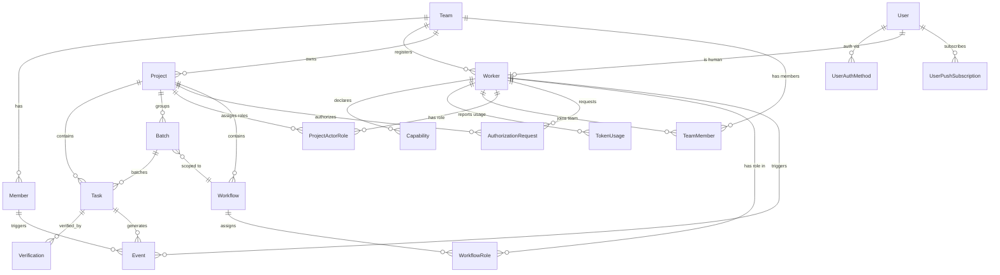

# Synapse 核心数据模型

> 版本：v2.1 · 2026-07-18（P100-B74 文档膨胀治理 — §3 拆分 · P100-B78 实体补齐 — 19→23 实体 · 新增 §3.20-3.23）
> ⚠️ **术语说明（S-016 · P9-B97 修复）**：本文档已同步至 Worker 命名（原 Agent），与 ORM 模型 `Worker` / API 路径 `/v1/workers/` 一致。`ownerType`/`actorType` 枚举值 `agent` 保留为代码常量（历史兼容）。
> 依赖：PRD §核心数据概念
> 被引用：protocol.md §契约交叉引用 · security-model.md §授权
> 子文档：[`data-model-entities.md`](data-model-entities.md) — §3 实体定义（23 实体完整属性表·状态机·约束·设计决策）

---

## 1. 设计原则

| 原则 | 说明 |
|------|------|
| **人机对等** | Member（人）和 Worker（AI）统一抽象为 Actor，Task.owner 不区分类型 |
| **事件溯源** | 所有状态变更通过不可变 Event 记录，状态 = 事件折叠投影 |
| **租户隔离** | Team 是最高边界，跨 Team 数据默认不可见 |
| **显式能力** | Worker 必须声明 Capability，只能执行已声明能力范围内的操作 |
| **验证先行** | Task 创建时必须定义 Verification 条件，无验证条件 = 不可完成 |

---

## 2. ER 总览



---

## 3. 实体定义

> **详细实体定义已拆分至 [`data-model-entities.md`](data-model-entities.md)**。以下 23 个实体的完整属性表、状态机、约束条件和设计决策请参见该文件。

| # | 实体 | 说明 |
|:--:|------|------|
| 3.1 | Team | 租户边界 |
| 3.2 | Member | 人类成员（旧实体，正在被 User + TeamMember 替代） |
| 3.3 | Worker | AI/人类工作者注册身份 |
| 3.4 | Capability | Worker 能力声明 |
| 3.5 | Project | 项目协调空间 |
| 3.6 | Task | 最小工作单元 — 人机对等核心体现 |
| 3.7 | Batch | 分布式执行最小分配单元（执行原子） |
| 3.8 | Verification | 任务完成验证条件 |
| 3.9 | Event | 不可变状态变更记录（"账本"） |
| 3.10 | AnalysisRecord | 不可变分析账本 🆕 P6 |
| 3.11 | TokenUsage | Token 消耗记录 🆕 P9 |
| 3.12 | AuthorizationRequest | 双类型单表授权请求 🆕 P10 |
| 3.13 | Workflow | 项目内协调上下文 🆕 P10 |
| 3.14 | WorkflowRole | Workflow 内角色分配 🆕 P10 |
| 3.15 | User | 用户账户 🆕 P10 |
| 3.16 | UserAuthMethod | 第三方登录绑定 🆕 P10 |
| 3.17 | TeamMember | Worker-Team 关联（替代旧 Member） 🆕 P10 |
| 3.18 | ProjectActorRole | 项目级角色分配 🆕 P10 |
| 3.19 | UserPushSubscription | WebPush 浏览器订阅 🆕 P10 |
| 3.20 | ProtectionReport | 保护报告 — 跨Project访问/敏感重叠/能力漂移检测 🆕 P10 |
| 3.21 | CircuitBreaker | 熔断器 — Worker/Project 级熔断保护 🆕 P10 |
| 3.22 | DecisionAudit | 决策审计 — 不可变授权决策日志 🆕 P10 |
| 3.23 | TaskWorkerConversation | A2A 结构化协调消息 🆕 P10 |

---

## 4. 关系矩阵

| 源 → 目标 | 基数 | 说明 |
|-----------|------|------|
| Team → Member | 1 : N | 一个 Team 有多个人类成员（旧实体，正被 Worker + TeamMember 替代） |
| Team → Worker | 1 : N | 一个 Team 注册多个 Worker |
| Team → TeamMember | 1 : N | 一个 Team 有多个成员关联记录（新路径）🆕 |
| Team → Project | 1 : N | 一个 Team 有多个项目 |
| User → UserAuthMethod | 1 : N | 一个 User 可绑定多个认证方式（Email + OAuth）🆕 |
| User → Worker | 1 : 1 | 一个 User 对应一个 `actor_type=human` 的 Worker 🆕 |
| Worker → Worker | 1 : N | 一个 Worker（人类）可注册多个 Agent Worker（`registered_by` 自引用） |
| Worker → TeamMember | 1 : N | 一个 Worker 可加入多个 Team 🆕 |
| Worker → ProjectActorRole | 1 : N | 一个 Worker 可在多个 Project 中有角色 🆕 |
| Worker → AuthorizationRequest | 1 : N | 一个 Worker 可发起多个授权请求（worker_id FK）🆕 |
| Worker → AuthorizationRequest | 1 : N | 一个 Worker（人类）可响应多个授权请求（responded_by_worker_id FK）🆕 |
| Worker → WorkflowRole | 1 : N | 一个 Worker 可在多个 Workflow 中有角色 🆕 |
| Project → Task | 1 : N | 一个项目包含多个任务 |
| Project → Batch | 1 : N | 一个项目有多个任务包 |
| Project → AnalysisRecord | 1 : N | 一个项目包含多个分析记录 🆕 |
| Project → ProjectActorRole | 1 : N | 一个 Project 有多个角色分配 🆕 |
| Project → AuthorizationRequest | 1 : N | 一个 Project 包含多个授权请求 🆕 |
| Project → Workflow | 1 : N | 一个 Project 有多个 Workflow 🆕 |
| Batch → Task | 1 : N | 一个任务包包含多个任务（可选关联） |
| Batch → Workflow | N : 1 | 一个任务包可选归属到一个 Workflow（`workflow_id` NULLABLE）🆕 |
| Batch → AnalysisRecord | 1 : N | 一个任务包可从某个分析产出 🆕 |
| Workflow → WorkflowRole | 1 : N | 一个 Workflow 有多个角色分配 🆕 |
| Task → Task | 1 : N | 父任务可有多个子任务（`parentTaskId`） |
| Task → Verification | 1 : N | 一个任务至少 1 条验证条件 |
| Worker → Capability | 1 : N | 一个 Worker 声明多项能力 |
| Worker → TokenUsage | 1 : N | 一个 Worker 产生多条 token 消耗记录 🆕 |
| User → UserPushSubscription | 1 : N | 一个 User 可有多个浏览器订阅 🆕 |
| Actor → Event | 1 : N | Member 或 Worker 触发多条事件 |

---

## 5. Actor 统一抽象

Member 和 Worker 在任务模型中地位对等。以下是统一视角：

```
       ┌──────────┐
       │   Actor   │  ← 概念抽象（不建表）
       └────┬─────┘
      ┌─────┴─────┐
      │           │
  ┌───┴───┐   ┌───┴───┐
  │Member │   │ Worker │
  │(人类) │   │ (AI)  │
  └───┬───┘   └───┬───┘
      │           │
      └─────┬─────┘
            │
      ┌─────┴─────┐
      │   Task    │  ownerType + ownerId 指向任一
      └───────────┘
```

**对等性体现**：
- Task.owner 可以是 Member 也可以是 Worker —— API 和 UI 不做区分
- 两者都在 Event 流中以 Actor 身份出现
- 两者都可以创建、认领、完成 Task
- 能力不同（Worker 必须声明 Capability，人类默认全能），但**地位不同不是层级不同**

**差异点**（不是层级，是特性）：
| 维度 | Member（人） | Agent（AI） |
|------|------------|------------|
| 能力范围 | 无声明限制 | 必须声明 Capability |
| 认领方式 | 主动领取或被动分配 | 被动分配（或自动匹配） |
| 验证权限 | 可验证任何 Task | 只能验证自己完成的 Task |
| 创建 Task | 随意 | 需 `task.create` 能力 |
| 认证方式 | OAuth/JWT | API Key |

---

## 6. 查询模式

### 6.1 常见查询

| 场景 | 查询路径 |
|------|---------|
| 团队所有活跃任务 | `Team → Project → Task(status != completed/cancelled)` |
| 某 Worker 当前任务 | `Task(ownerType=agent, ownerId=X, status=in_progress)` |
| 某 Batch 完成进度 | `count(Task in Batch where status=completed) / count(all)` |
| 某 Member 今日活动 | `Event(actorType=member, actorId=X, createdAt > today)` |
| 项目事件时间线 | `Event(teamId=X, targetType=task, order by createdAt DESC)` |
| 某 Workflow 角色分配 | `WorkflowRole(workflow_id=X)` JOIN Worker — 按 role 筛选 |

### 6.2 聚合视图

```sql
-- Worker 效能视图（示例查询，非建表 SQL）
SELECT
  a.name AS agent_name,
  COUNT(t.id) AS tasks_completed,
  AVG(t.completedAt - t.createdAt) AS avg_completion_time,
  COUNT(v.id) FILTER (WHERE v.status = 'failed') AS verification_failures
FROM Worker a
JOIN Task t ON t.ownerType = 'agent' AND t.ownerId = a.id
LEFT JOIN Verification v ON v.taskId = t.id
WHERE t.status = 'completed'
GROUP BY a.id;
```

---

## 7. JSONB 扩展策略

以下字段使用 JSONB 而非固定列，因为它们在 MVP 阶段不稳定：

| 位置 | 字段 | 内容示例 |
|------|------|---------|
| Worker.metadata_ | 速率限制、超时配置 | `{"rateLimit": {"maxPerMin": 10}, "timeoutMs": 30000}` |
| Task.metadata | 外部链接、PR 引用 | `{"prUrl": "...", "branchName": "feat/login", "externalRefs": [...]}` |
| Verification.criteria | 自动化验证规则 | `{"ciCheckNames": ["lint", "test", "build"], "minCoverage": 0.8}` |
| Event.payload | 变更前后快照 | `{"changes": {...}, "snapshot": {...}}` |

**JSONB 使用原则**：
- 用于查询/过滤的字段 → 固定列
- 仅用于展示/透传的字段 → JSONB
- 跨实体关联的外键 → 永远不用 JSONB

---

## 8. ID 设计

| 前缀 | 实体 | 示例 |
|------|------|------|
| `tea_` | Team | `tea_7a3b2c1d...` |
| `mem_` | Member（旧） | `mem_9f4e8d2a...` |
| `usr_` | User | `usr_3a1b5c7d...` 🆕 |
| `uam_` | UserAuthMethod | `uam_9e4f8d2a...` 🆕 |
| `ag_` | Worker | `ag_3c7b1e5f...` |
| `cap_` | Capability | `cap_2d8a6f4b...` |
| `prj_` | Project | `prj_5e9c3a7d...` |
| `par_` | ProjectActorRole | `par_7b1d9f3c...` 🆕 |
| `tsk_` | Task | `tsk_1b4d8f2e...` |
| `bat_` | Batch | `bat_8f2a6c4e...` |
| `ver_` | Verification | `ver_4d7b9f1a...` |
| `evt_` | Event | `evt_6c0e3a5f...` |
| `anl_` | AnalysisRecord | `anl_9b3d1f5e...` |
| `tku_` | TokenUsage | `tku_7a1b5c9d...` |
| `areq_` | AuthorizationRequest | `areq_7f1b9d3c...` 🆕 |
| `wfl_` | Workflow | `wfl_8c1a4e6b...` 🆕 |
| `wfr_` | WorkflowRole | `wfr_2d5f7a9c...` 🆕 |
| `ups_` | UserPushSubscription | `ups_8e4b2a1f...` 🆕 |

格式：`{prefix}{UUIDv7 前 16 位}`，兼顾可读性和唯一性。

---

## 9. 设计决策记录

### D-001: 为什么 Member 和 Worker 不在同一张表？

**问题**：既然强调人机对等，为什么不统一为一张 `Actor` 表？

**决策**：分表。

**理由**：
1. Member 和 Worker 的属性交集小——认证方式、能力模型、生命周期完全不同
2. 统一 Actor 表会导致大量 NULL 列（Member 不需要 api_key_hash，Worker 不需要 userId）
3. 关系清晰度——`registered_by` 表示 Member→Worker 的注册关系，统一表会变成自引用
4. 对等性体现在**Task.owner 不区分类型**和**Event.actor 统一模型**，不需要同一张表来实现

### D-002: 为什么不用软删除？

**问题**：Task/Project 删除是真删除还是软删除？

**决策**：关键实体使用状态标记 + Event 记录。

**理由**：
1. `Task.status = cancelled` 保留历史记录
2. `Project.status = archived` 保留数据
3. `Worker.status = removed` 断开连接但不删除事件历史
4. 所有状态变更都产生 Event，审计链完整
5. GDPR 等合规需求 → 未来可加 `deletedAt` + 定期清理策略

### D-003: 为什么 Verification 必须在 Task 创建时定义？

**问题**：不能在工作完成后补验证条件吗？

**决策**：创建时必填，至少 1 条。

**理由**：
1. 源自 glassmind 的反模式——没有验证条件 = 不知道"做完"是什么样子
2. 后补验证条件会导致标准降低——"做完了再想怎么验证" → 永远通过
3. 强制创建时思考验收标准 → 更好的任务拆分质量

---

## 10. 版本兼容

未来扩展方向（暂不实现，预留空间）：
- **Skill** — Worker Capability 的聚合，一个 Skill 包含多个 Capability
- **Template** — Task/Batch/Project 的模板化
- **Integration** — 外部工具（GitHub、Slack、Linear）的连接配置
- **Metric** — Worker 效能的时序指标存储
- **Plan** — 类似 glassmind Plan 的概念，连接多个 Batch

---

> **下一站**：`protocol.md` — 基于此数据模型定义人机协调消息协议。
