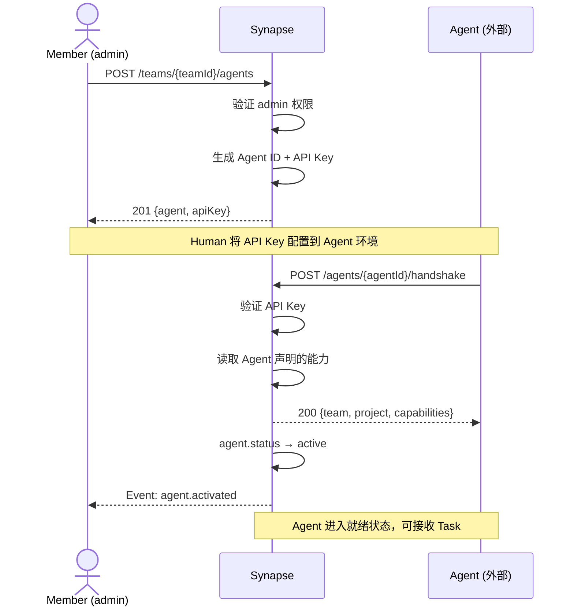
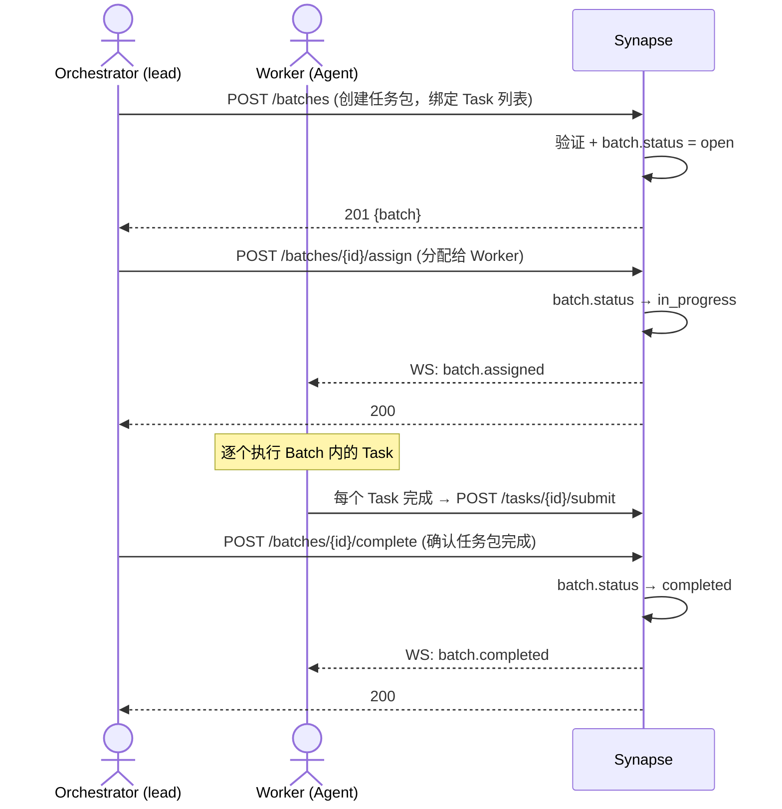
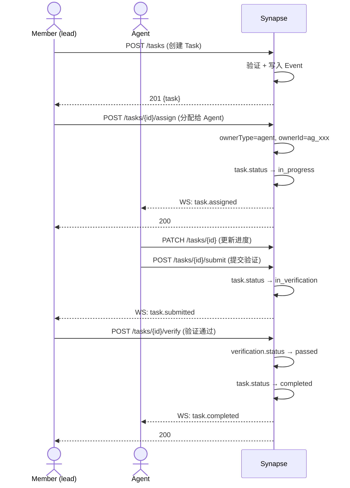
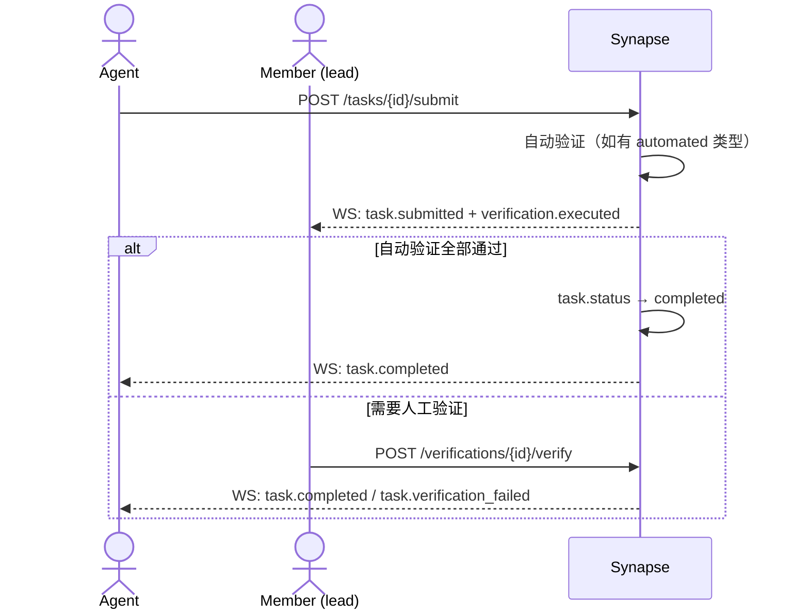

# Synapse 人机协调协议

> 版本：v1.0-draft · 2026-07-03
> 依赖：data-model.md（实体定义）· PRD §核心价值主张
> 被引用：security-model.md §Agent 权限 · architecture.md §技术选型
> 最后更新：2026-07-14（P9-B65 Handshake 简化 — §3.2 capabilities 支持 str 简写 + agentVersion 可选）

---

## 1. 协议定位

本协议定义**外部 Agent 和人类如何与 Synapse 交互**。它是 Synapse 的核心壁垒——不是"又一个任务管理 API"，而是**第一个把 Agent 当一等公民对待的协调协议**。

### 1.1 设计原则

| 原则 | 说明 |
|------|------|
| **Actor 无关** | API 不区分请求来自 Member 还是 Agent——同一个端点，不同的权限检查 |
| **能力驱动** | Agent 只能执行已声明 Capability 对应的操作 |
| **事件先行** | 状态变更 = 写入 Event + 推送订阅者，不依赖轮询 |
| **渐进披露** | Agent 只看到自己需要的信息——分配给它的 Task 详情，所属 Project 的上下文摘要 |
| **幂等优先** | 所有写操作支持幂等键，网络重试安全 |

> **角色映射**：本协议中的时序图使用 `Member (lead)` 和 `Agent` 作为通用标签。在三角色模型（P7 D1 v2）中：`Member (lead)` 对应 **Orchestrator**（编排者——拆任务+分配+验收），`Agent` 对应 **Builder**（构建者——执行任务），`Member (admin)` 可对应 **Steward**（协理——安全/规范/仲裁/绩效/评估）。协议不绑定角色，但权限检查（`admin`/`lead`/`member`）与三角色职责对应。

### 1.2 协议分层

```
┌──────────────────────────────────────┐
│         应用层：消息语义              │  ← 本文档定义
│  (Task 生命周期、Verification、...)  │
├──────────────────────────────────────┤
│         传输层：REST + WebSocket      │
│  (JSON over HTTPS, WSS)              │
├──────────────────────────────────────┤
│         安全层：AuthN + AuthZ         │  ← security-model.md
│  (JWT / API Key / RBAC)              │
└──────────────────────────────────────┘
```

---

## 2. 传输层

### 2.1 REST API

- **Base URL**: `https://api.synapse.dev/v1`
- **Content-Type**: `application/json`
- **编码**: UTF-8
- **分页**: Cursor-based（`?cursor=xxx&limit=50`），响应含 `nextCursor`
- **幂等**: 写操作接受 `Idempotency-Key: <uuid>` 头

### 2.2 实时通道（WebSocket）

```
wss://api.synapse.dev/v1/ws?token=<jwt_or_apikey>
```

WebSocket 用于：
- Agent 接收 Task 分配通知
- 状态变更实时推送
- Verification 结果通知

**心跳**: 30s ping/pong，60s 无响应 → 断开重连。

### 2.3 Webhook（备选）

对于不支持持久连接的 Agent，提供 Webhook 模式：
- Agent 注册时提供 `webhookUrl`
- Synapse 向该 URL POST 事件
- 重试策略：1s → 5s → 25s → 125s → 放弃（指数退避，最多 4 次）

---

## 3. Agent 注册协议

### 3.1 注册流程



### 3.2 Handshake 请求

```http
POST /v1/agents/{agentId}/handshake
Authorization: Bearer <api_key>
Content-Type: application/json

{
  "agentVersion": "1.0.0",
  "capabilities": [
    "code.review",
    "task.update",
    {
      "name": "deploy.service",
      "description": "部署服务到生产环境",
      "inputSchema": { ... },
      "outputSchema": { ... }
    }
  ],
  "supportedEvents": ["task.assigned", "verification.executed"],
  "preferredChannel": "websocket"
}
```

> `capabilities` 支持两种格式：简写 `"code.review"`（等价于 `{"name": "code.review"}`）和完整对象 `{"name": "...", "description": "...", ...}`。可混用。`agentVersion` 可选，默认 `"0.0.0"`。

**响应**：
```json
{
  "agent": {
    "id": "ag_3c7b1e5f",
    "name": "Claude-Architect",
    "status": "active"
  },
  "team": {
    "id": "tea_7a3b2c1d",
    "name": "Acme Corp",
    "members": [
      {"id": "mem_9f4e8d2a", "displayName": "Alice", "role": "admin"}
    ]
  },
  "activeProjects": [
    {
      "id": "prj_5e9c3a7d",
      "name": "api-service",
      "myTasks": 3,
      "myActiveTasks": 1
    }
  ]
}
```

### 3.3 心跳与存活

Agent 每 60 秒发送心跳：

```http
POST /v1/agents/{agentId}/heartbeat
Authorization: Bearer <api_key>

{ "currentLoad": 3, "currentTaskId": "tsk_1b4d8f2e" }
```

60s 内无心跳 → `agent.status → paused`，不再分配新 Task。

---

## 4. Batch 分配协议（任务包）

Batch（任务包）是分布式执行的**最小分配单元**。Orchestrator 将一组 Task 打包为一个 Batch，整体分配给一个 Worker。这替代了逐个 Task 分配——把 N 次 assign/complete 往返压缩为 1 次。

### 4.1 Batch 生命周期



### 4.2 创建 Batch

```http
POST /v1/projects/{projectId}/batches
Authorization: Bearer <jwt>
Content-Type: application/json

{
  "name": "P7-B1 数据模型刷新",
  "description": "更新 Batch 定义为执行原子，对齐三份文档",
  "taskIds": ["tsk_1b4d8f2e", "tsk_9f2c3a1b", "tsk_5e9c3a7d"]
}
```

### 4.3 分配 Batch

```http
POST /v1/batches/{batchId}/assign
Authorization: Bearer <jwt>
Content-Type: application/json

{
  "assigneeType": "agent",
  "assigneeId": "ag_3c7b1e5f"
}
```

分配后，Batch 内所有 Task 的 owner 自动设为该 Worker。

### 4.4 完成 Batch

```http
POST /v1/batches/{batchId}/complete
Authorization: Bearer <jwt>
```

Batch 完成不要求所有子 Task 都是 `completed`——由 Orchestrator 人工判定（MVP 简化策略）。

---

## 5. Task 生命周期协议

Task 是需求原子（最小工作单元）。Task 的创建和验收在 §4 Batch 分配之后进行——Orchestrator 先创建 Task，打包为 Batch 再分配。

> **MVP 双路径**：Task 可通过两种方式分配：① **推荐** — 打包为 Batch 后整体分配（§4）；② **兼容** — 直接分配单个 Task（本节 `POST /tasks/{id}/assign`）。远期以 Batch 分配为主，单个 Task 分配作为例外。

### 5.1 完整生命周期（单个 Task 分配，兼容路径）



### 5.2 任务认领（Pull 模式，远期）

> **远期方向**：当前 Pull 模式是 Task 级别的（兼容路径）。P7-009 规划的 Batch 级 Pull（Worker 从 Task Pool 自选 Task 组 Batch）是远期主力模式。详见 P7-009。

Agent 也可以主动拉取可认领的任务：

```http
GET /v1/projects/{projectId}/tasks/available?capability=code.review
Authorization: Bearer <api_key>
```

**响应**：
```json
{
  "tasks": [
    {
      "id": "tsk_1b4d8f2e",
      "title": "审查 PR #342 的认证模块变更",
      "priority": "p1",
      "estimatedEffort": "s",
      "requiredCapability": "code.review",
      "context": {
        "prUrl": "https://github.com/acme/api/pull/342",
        "changedFiles": 12,
        "linesChanged": 234
      }
    }
  ],
  "nextCursor": "tsk_9f2c3a1b"
}
```

Agent 认领：
```http
POST /v1/tasks/{taskId}/claim
Authorization: Bearer <api_key>
```

### 5.3 进度更新

Agent 在工作过程中更新进度（可选，但推荐）：

```http
PATCH /v1/tasks/{taskId}
Authorization: Bearer <api_key>
Content-Type: application/json

{
  "status": "in_progress",
  "progress": {
    "percentComplete": 60,
    "currentStep": "运行测试套件",
    "notes": "发现 3 个失败测试，正在修复"
  }
}
```

### 5.4 提交验证

```http
POST /v1/tasks/{taskId}/submit
Authorization: Bearer <api_key>
Content-Type: application/json

{
  "summary": "审查完成，发现 2 个安全问题（见详情）",
  "evidence": {
    "findingsFileUrl": "https://...",
    "ciPassed": true,
    "testResults": { "passed": 142, "failed": 0 }
  },
  "verificationResults": [
    {
      "verificationId": "ver_4d7b9f1a",
      "status": "passed",
      "evidence": "所有 CI 检查通过"
    }
  ]
}
```

---

## 6. Event 订阅协议

### 6.1 WebSocket 事件流

```
Client → Server:  { "type": "subscribe", "topics": ["task.assigned", "task.completed"] }
Server → Client:  { "type": "event", "data": { ... } }
Client → Server:  { "type": "ping" }
Server → Client:  { "type": "pong" }
```

### 6.2 事件格式

```json
{
  "type": "event",
  "eventId": "evt_6c0e3a5f",
  "eventType": "task.assigned",
  "data": {
    "task": {
      "id": "tsk_1b4d8f2e",
      "title": "审查 PR #342",
      "priority": "p1",
      "context": { ... }
    },
    "assignedBy": {
      "id": "mem_9f4e8d2a",
      "displayName": "Alice"
    }
  },
  "timestamp": "2026-07-03T10:30:00Z"
}
```

### 6.3 事件类型 × 订阅者

| 事件类型 | 推送对象 | 说明 |
|---------|---------|------|
| `batch.created` | Project members | 新任务包创建 |
| `batch.assigned` | Batch assignee (Worker) | 任务包分配给 Worker |
| `batch.completed` | Project members | 任务包完成 |
| `batch.cancelled` | Batch assignee + Project Lead(s) | 任务包取消 |
| `task.assigned` | Task.owner | 新任务分配（Batch 分配后自动触发） |
| `task.submitted` | Project Lead(s) | 任务提交验证 |
| `task.completed` | Task.owner + Lead | 验证通过 |
| `task.verification_failed` | Task.owner | 验证失败 |
| `task.cancelled` | Task.owner | 任务取消 |
| `verification.executed` | Member (lead) | 请求人工验证 |
| `agent.activated` | Team admins | Agent 上线 |
| `agent.paused` | Team admins | Agent 离线 |
| `comment.added` | Task 参与者 | 新增评论 |

---

## 7. Verification 协议

### 7.1 验证流程



### 7.2 验证类型处理

| 类型 | 处理方式 |
|------|---------|
| `automated` | Synapse 执行 criteria 中的规则自动判定 |
| `manual` | 推送给 Project Lead，等待人工操作 |
| `check_list` | Agent 逐项标记，人工最终确认 |

### 7.3 人工验证请求

```http
POST /v1/verifications/{verificationId}/verify
Authorization: Bearer <jwt>
Content-Type: application/json

{
  "status": "passed",
  "comment": "代码质量好，安全问题已修复",
  "evidence": { ... }
}
```

---

## 8. 通信协议（评论与讨论）

> ⚠️ **计划中（Phase 3+）**：评论端点当前代码中尚未实现。MVP 阶段通过 Task.description 更新 + Event 流实现基本沟通。以下为设计规范，供后续实现参考。

Task 上的评论是 Member-Agent 和 Agent-Agent 通信的基础通道。

```http
POST /v1/tasks/{taskId}/comments   ← ⬜ 未实现
Authorization: Bearer <jwt_or_apikey>
Content-Type: application/json

{
  "body": "这个函数的错误处理需要加强——当 API 返回 429 时没有重试逻辑。",
  "mentions": ["mem_9f4e8d2a"]  // @某人
}
```

**评论通知**：被 @的人收到 `comment.added` 事件。Task owner 始终收到所有评论。

---

## 9. API 端点目录

> ✅ = 已实现（P9-B84, 71 端点） · ⬜ = 计划中（远期）

### 9.1 Team

| 方法 | 路径 | 说明 | 权限 | 状态 |
|------|------|------|------|:--:|
| `GET` | `/teams/{teamId}` | 获取团队信息 | member+ | ✅ |
| `PATCH` | `/teams/{teamId}` | 更新团队设置 | admin | ✅ |
| `GET` | `/teams/{teamId}/members` | 成员列表 | member+ | ✅ |
| `POST` | `/teams/{teamId}/members` | 邀请成员 | admin | ✅ |
| `DELETE` | `/teams/{teamId}/members/{memberId}` | 移除成员 | admin | ✅ |

### 9.2 Agent

| 方法 | 路径 | 说明 | 权限 | 状态 |
|------|------|------|------|:--:|
| `POST` | `/teams/{teamId}/agents` | 注册 Agent | admin | ✅ |
| `GET` | `/teams/{teamId}/agents` | Agent 列表 | member+ | ✅ |
| `GET` | `/agents/{agentId}` | Agent 详情 | member+ | ✅ |
| `PATCH` | `/agents/{agentId}` | 更新 Agent 配置 | admin | ⬜ |
| `DELETE` | `/agents/{agentId}` | 移除 Agent | admin | ✅ |
| `POST` | `/agents/{agentId}/handshake` | Agent 握手 | Agent 自身 | ✅ |
| `POST` | `/agents/{agentId}/heartbeat` | Agent 心跳 | Agent 自身 | ✅ |

### 9.3 Project

| 方法 | 路径 | 说明 | 权限 | 状态 |
|------|------|------|------|:--:|
| `POST` | `/teams/{teamId}/projects` | 创建项目 | lead+ | ✅ |
| `GET` | `/projects/{projectId}` | 项目详情 | member+ | ✅ |
| `PATCH` | `/projects/{projectId}` | 更新项目 | lead+ | ✅ |
| `POST` | `/projects/{projectId}/archive` | 归档项目 | admin | ✅ |

### 9.4 Task

| 方法 | 路径 | 说明 | 权限 | 状态 |
|------|------|------|------|:--:|
| `POST` | `/projects/{projectId}/tasks` | 创建任务 | member+ | ✅ |
| `GET` | `/tasks/{taskId}` | 任务详情 | member+ | ✅ |
| `PATCH` | `/tasks/{taskId}` | 更新任务 | owner 或 lead+ | ✅ |
| `GET` | `/projects/{projectId}/tasks/available` | 可认领任务 | Agent | ✅ |
| `POST` | `/tasks/{taskId}/claim` | 认领任务 | Agent | ✅ |
| `POST` | `/tasks/{taskId}/assign` | 分配任务 | lead+ | ✅ |
| `POST` | `/tasks/{taskId}/submit` | 提交验证 | owner | ✅ |
| `POST` | `/tasks/{taskId}/cancel` | 取消任务 | lead+ | ✅ |

### 9.5 Batch（任务包）

| 方法 | 路径 | 说明 | 权限 | 状态 |
|------|------|------|------|:--:|
| `POST` | `/projects/{projectId}/batches` | 创建任务包 | lead+ | ✅ |
| `GET` | `/batches/{batchId}` | 任务包详情 | member+ | ✅ |
| `PATCH` | `/batches/{batchId}` | 更新任务包 | lead+ | ⬜ |
| `POST` | `/batches/{batchId}/assign` | 分配任务包给 Worker | lead+ | ✅ |
| `POST` | `/batches/{batchId}/claim` | Worker 认领整个任务包 | member+ | ✅ |
| `POST` | `/batches/{batchId}/complete` | 确认任务包完成 | lead+ | ⬜ |
| `POST` | `/batches/{batchId}/cancel` | 取消任务包 | lead+ | ⬜ |

### 9.6 Verification

| 方法 | 路径 | 说明 | 权限 | 状态 |
|------|------|------|------|:--:|
| `POST` | `/verifications/{verificationId}/verify` | 执行验证 | lead+ (manual) / system (automated) | ✅ |
| `GET` | `/tasks/{taskId}/verifications` | 查看验证条件 | member+ | ✅ |

### 9.7 Event

| 方法 | 路径 | 说明 | 权限 | 状态 |
|------|------|------|------|:--:|
| `GET` | `/teams/{teamId}/events` | 事件流（分页） | member+ | ✅ |
| `GET` | `/projects/{projectId}/events` | 项目事件流 | member+ | ✅ |
| `WS` | `/v1/ws` | WebSocket 实时订阅 | member+/Agent | ✅ |

> **71 端点已注册（OpenAPI）**。仍计划中：`PATCH /agents/{id}`、`PATCH /batches/{id}`、`POST /batches/{id}/complete`、`POST /batches/{id}/cancel`（远期）。`POST /batches/{id}/assign` 已实现 ✅（P9-B57）。WebSocket `/v1/ws` 已实现 ✅（P3-B1）。

---

## 10. 错误处理

### 10.1 错误格式

```json
{
  "error": {
    "code": "TASK_NOT_CLAIMABLE",
    "message": "该任务已被认领或不可认领",
    "details": {
      "taskId": "tsk_1b4d8f2e",
      "currentStatus": "in_progress",
      "currentOwner": "ag_7a3b2c1d"
    }
  },
  "requestId": "req_9f4e8d2a"
}
```

### 10.2 错误码分类

| HTTP 状态 | 错误码前缀 | 示例 |
|-----------|----------|------|
| 400 | `INVALID_*` | `INVALID_STATUS_TRANSITION` |
| 401 | `AUTH_*` | `AUTH_INVALID_API_KEY` |
| 403 | `FORBIDDEN_*` | `FORBIDDEN_CAPABILITY_REQUIRED` |
| 404 | `NOT_FOUND_*` | `NOT_FOUND_TASK` |
| 409 | `CONFLICT_*` | `CONFLICT_TASK_ALREADY_CLAIMED` |
| 429 | `RATE_LIMITED` | — |
| 500 | `INTERNAL_*` | `INTERNAL_EVENT_WRITE_FAILED` |

### 10.3 Agent 错误处理指南

```
Agent 收到 4xx → 不重试，报告给人
Agent 收到 429 → 等 Retry-After 秒后重试
Agent 收到 5xx → 指数退避重试（最多 3 次）
Agent 收到 WS 断开 → 等 1s → 重连 → 失败则 5s → 25s → 报告
```

---

## 11. 速率限制

| 角色 | REST 限制 | WS 限制 |
|------|----------|---------|
| Member | 300 req/min | 无限制 |
| Agent（active） | 60 req/min | 10 msg/s |
| Agent（pending） | 0 | 0 |

速率限制头：`X-RateLimit-Remaining`, `X-RateLimit-Reset`, `Retry-After`

---

## 12. API 版本策略

- **版本号在 URL 中**：`/v1/...`
- **向后兼容承诺**：同一大版本内不破坏现有字段（只增不减）
- **废弃流程**：标记 `Deprecation: true` 响应头 → 保留 2 个小版本 → 删除
- **变更日志**：`docs/decisions/api-changelog.md`

---

## 13. 与 data-model.md 的契约交叉引用

| 协议概念 | data-model 实体 | 对应端点 |
|---------|----------------|---------|
| Agent 注册 + 握手 | Agent, Capability | `POST /agents/{id}/handshake` |
| Batch 创建 + 分配 + 完成 | Batch, Task | `POST /batches`, `POST /batches/{id}/assign`, `POST /batches/{id}/complete` |
| Task 创建 + 提交 + 验收 | Task, Event | `POST /tasks`, `POST /tasks/{id}/submit` |
| Task 状态流转 | Task 状态机 | `PATCH /tasks/{id}` |
| 验证 | Verification | `POST /verifications/{id}/verify` |
| 事件订阅 | Event | `GET /events`, WebSocket |
| 评论 | Event (comment.added) | `POST /tasks/{id}/comments` ⬜ |

---

> **下一站**：`security-model.md` — 基于数据模型和协议端点的权限矩阵。
