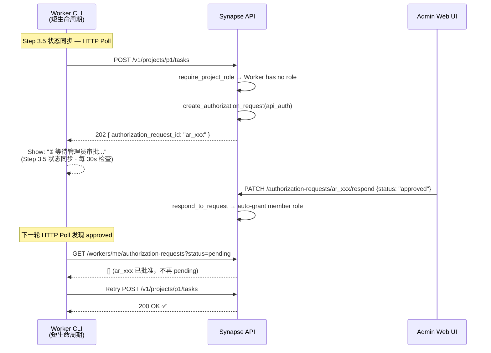
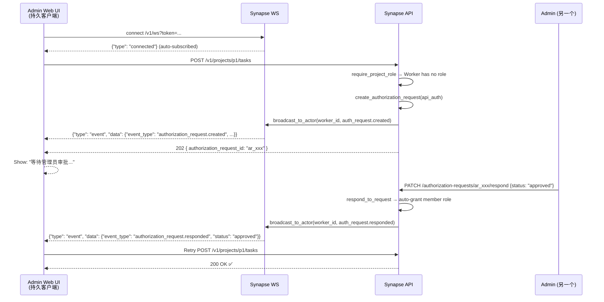
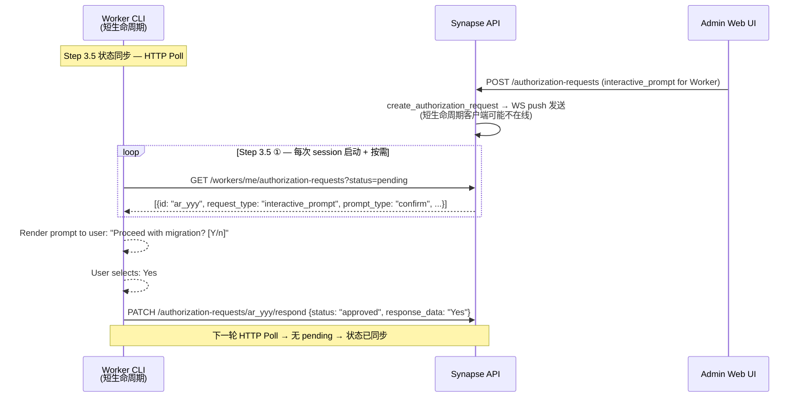
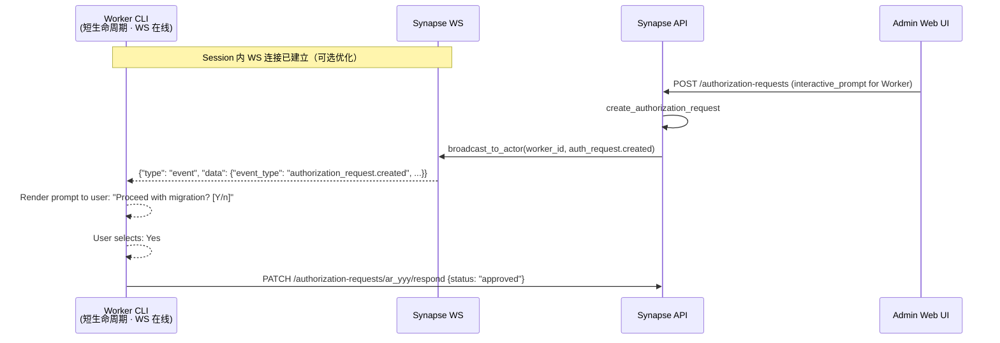
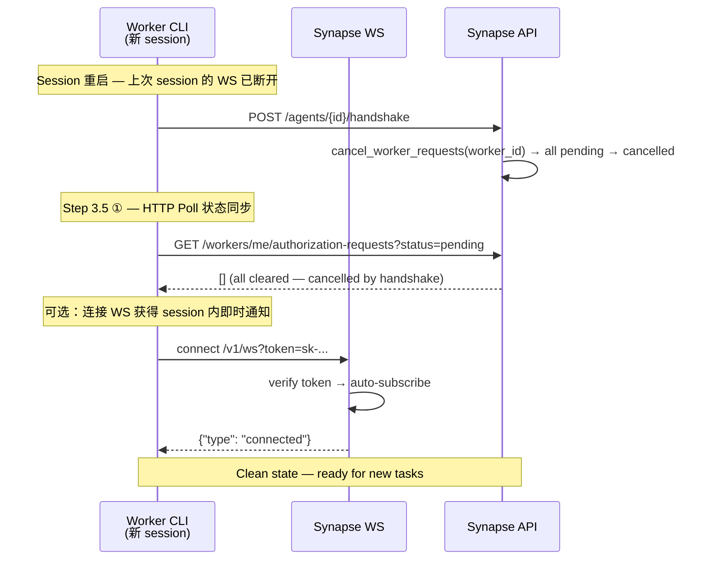

# Worker-Admin 交互流程架构

> P10-B32~B45：议题⑦ 通知通道全链路 — Worker 侧双通道（B31/B32）+ Admin 侧 Email（B33）+ Webhook（B34）+ WebPush（B44/B45）= 完整四通道闭环 🎉
> P11-B26/B27：双通道重新定位 — HTTP Poll 主通道（短生命周期客户端）+ WS Push 优化通道（持久客户端）
> 最后更新：2026-08-07（P100-B116 文档全量刷新 · 双通道架构无变更）

## §1 概述

Synapse 协调平台中，Worker（AI Agent / CLI 工具）在执行任务时可能遇到权限不足或需要人工决策的场景。系统通过 **AuthorizationRequest** 机制处理这些场景。

### Worker 侧：双通道发现

Worker 通过两条互补通道发现待处理的授权请求。**通道选择取决于客户端类型：**

| 客户端类型 | 生命周期 | 主通道 | 说明 |
|-----------|:---:|--------|------|
| **短生命周期 HTTP 客户端** | 数分钟 | HTTP Poll | Claude Code Worker / CLI 工具 — 请求-响应模型，无法在 session 间维持 WS 连接 |
| **持久客户端** | 小时-天 | WS Push | Admin Web UI / IDE 插件 — 可维持长连接，即时接收事件 |

**双通道对比**：

| 通道 | 延迟 | 定位 | 说明 |
|------|:--:|:--:|------|
| **HTTP Poll**（主） | ≤30s | 短生命周期客户端的标准模式 | GET /workers/me/authorization-requests · session 启动时全量拉取 + 按需轮询 |
| **WS Push**（优化） | <1s | 持久客户端的延迟优化 | /v1/ws → auto-subscribe → push 即时通知 · 短生命周期客户端可选（session 内可维持时启用） |

> 💡 **设计原则**：HTTP Poll 是可靠基线——所有状态持久化在服务端 DB 中，session 启动时全量拉取即可恢复完整上下文。WS Push 是延迟优化——不阻塞工作，不可用时自动回退到 HTTP Poll，不丢失任何信息。

### Admin 侧：四通道通知

Admin 通过四条互补通道接收授权请求通知：

| 通道 | 延迟 | Batch | 说明 |
|------|:--:|:--:|------|
| **WS Push** | <1s | B32 | 团队广播 — Admin Web UI 实时感知 |
| **Email** | 秒级 | B33 | 邮件通知 — Human admin 异步感知 |
| **Webhook** | 秒级 | B34 | HTTP POST — 外部系统集成 |
| **WebPush** | <1s | B44/B45 | 浏览器推送 — Admin 桌面通知 |

```
┌──────────────────────────────────────────────────────────┐
│  Worker (短生命周期 HTTP 客户端: CLI / Claude Code Agent)  │
│    │                                                     │
│    ├── HTTP Poll (主通道, ≤30s)                            │
│    │   └─ GET /workers/me/authorization-requests          │
│    │      session 启动时全量拉取 + 按需轮询                  │
│    │                                                     │
│    └── WS Push (可选优化, <1s)                             │
│        └─ /v1/ws → auto-subscribe → session 内即时通知     │
│           (不可用时自动回退到 HTTP Poll，不丢失信息)         │
│                                                          │
├──────────────────────────────────────────────────────────┤
│  Worker (持久客户端: Admin Web UI / IDE 插件)              │
│    │                                                     │
│    └── WS Push (主通道, <1s)                               │
│        └─ /v1/ws → auto-subscribe → 持久连接即时通知       │
│                                                          │
├──────────────────────────────────────────────────────────┤
│  Synapse API                                             │
│    ├─ require_project_role → 403→202 拦截器 (B31)         │
│    ├─ authorization_service → 四通道通知分发              │
│    │   ├─ WS Push to Worker (B32)                        │
│    │   ├─ Email to Admins (B33)                          │
│    │   ├─ Webhook POST (B34)                             │
│    │   └─ WebPush to Admin browsers (B44/B45)            │
│    └─ auto-grant on approval (B31)                       │
│                                                          │
├──────────────────────────────────────────────────────────┤
│  Admin                                                  │
│    ├─ Web UI: /approvals → PATCH respond → approve/deny  │
│    ├─ Email: auth_request_notification 模板              │
│    ├─ Webhook: HTTP POST event to external URL           │
│    └─ Browser: Service Worker push → notification        │
└──────────────────────────────────────────────────────────┘
```

**两种请求类型**：

| 类型 | 触发条件 | 示例场景 |
|------|---------|---------|
| `api_auth` | Worker 尝试访问其没有角色的 Project 资源 | Worker 第一次在 Project 上执行操作 |
| `interactive_prompt` | 系统/Admin 需要 Worker 的操作者做决策 | handoff 确认、方案选择、版本号输入 |

---

## §2 场景一：Worker 请求项目权限（api_auth）

### §2.1 HTTP 202 路径（B31 已实现）

```
Worker 发起 API 请求（带 API Key）
  → require_project_role 检查
    ├─ 有 role → 放行 ✅
    └─ 无 role → _infer_operation() 推断操作
         → authorization_service.create_authorization_request()
         → raise AuthorizationPendingError(status_code=202)
              {
                "error": "authorization_pending",
                "details": {
                  "authorization_request_id": "ar_xxx",
                  "status": "pending"
                }
              }
```

### §2.2 通知通道分发（B32→B45 四通道）

`create_authorization_request()` 完成后依次触发四条通知通道：

```
authorization_service.create_authorization_request()
  │
  ├─ [B32] WS Push to Worker (fire-and-forget · 持久客户端即时接收)
  │   └─ ws_manager.broadcast_to_actor(worker_id, {
  │        "type": "event",
  │        "data": {
  │          "event_type": "authorization_request.created",
  │          "authorization_request_id": "ar_xxx",
  │          "status": "pending",
  │          "request_type": "api_auth",
  │          "operation": "POST:/v1/projects/p1/tasks"
  │        }
  │      })
  │
  ├─ [B33] Email to Project Admins (fire-and-forget)
  │   └─ notify_project_admins() → list admin/lead Workers
  │       → Worker.user_id → User.email
  │       → send_email(auth_request_notification.html)
  │
  ├─ [B34] Webhook POST (fire-and-forget)
  │   └─ notify_webhook() → Project.webhook_url
  │       → httpx POST {event_type, request_id, worker_name, ...}
  │
  └─ [B45] WebPush to Admin Browsers (fire-and-forget)
      └─ notify_webpush() → list admin/lead Workers
          → User.push_subscriptions → pywebpush send
```

**Worker 侧发现机制**（P11-B26/B27 重新定位）：
- **持久客户端**（Admin Web UI）：WS Push 即时收到 → 展示给用户 "等待管理员审批..." → 无需轮询
- **短生命周期客户端**（Claude Code Worker）：HTTP Poll 在 session 启动时拉取（Step 3.5 状态同步）→ 发现 pending 请求 → 按需轮询或维持 WS 连接获得即时更新

### §2.3 管理员审批 → Auto-Grant → Worker 重试

```
Admin Web UI: /approvals → 看到 pending request → PATCH respond
  → authorization_service.respond_to_request()
    ├─ status = "approved" + request_type = "api_auth"
    │   → _auto_grant_project_membership(worker_id, project_id, role="member")
    ├─ event_store.record()           [团队广播]
    └─ ws_manager.broadcast_to_actor(record.worker_id, ...)  [Worker push · 持久客户端即时接收]
         {
           "type": "event",
           "data": {
             "event_type": "authorization_request.responded",
             "authorization_request_id": "ar_xxx",
             "status": "approved",
             "request_type": "api_auth"
           }
         }

Worker 发现 approved:
  ├─ 持久客户端：WS push 即时收到 → 重试原始请求
  └─ 短生命周期客户端：下一轮 HTTP Poll 发现 ar_xxx 不再 pending
       → 重试原始请求 → require_project_role 检查 → member role ✅ → 放行 🎉
```

**Auto-Grant 安全策略**：
- 仅 `api_auth` 类型触发（`interactive_prompt` 不触发）
- 仅授予最小权限 `member` 角色
- Worker 已有角色时保留不降级（`_auto_grant_project_membership` L378-379）

---

## §3 场景二：系统请求人工决策（interactive_prompt）

### §3.1 Prompt 创建

两种创建路径：

| 路径 | 触发方式 | 示例 |
|------|---------|------|
| **Handoff** | A2A 对话中检测到需要人工决策 | `POST /v1/conversations/{id}/messages` + message_type="handoff_request" |
| **Admin 手动** | Admin 通过 API 直接创建 | `POST /v1/authorization-requests` |

### §3.2 Worker 发现（双通道 · HTTP-first）

```
短生命周期客户端（Claude Code Worker · 标准模式）:
  session 启动 → Step 3.5 状态同步
    → GET /workers/me/authorization-requests?status=pending
    → 发现 pending prompts → 展示给用户（CLI/UI 渲染）
  session 内按需轮询或维持 WS 连接获得即时更新

持久客户端（Admin Web UI · 主通道）:
  authorization_service.create_authorization_request()
    → ws_manager.broadcast_to_actor(worker_id, {
        "event_type": "authorization_request.created",
        "request_type": "interactive_prompt",
        "prompt_type": "confirm",    // or "choice" / "input"
        "prompt_message": "..."
      })
  WS 在线 → 即时收到 → 展示给用户

短生命周期客户端 WS 可选:
  session 内维持 WS 连接 → 同持久客户端路径，降低感知延迟
  WS 不可用 → 回退到 HTTP Poll，不丢失信息
```

### §3.3 CLI 渲染 → 用户响应 → PATCH respond

```
Worker 收到 prompt 后，根据 prompt_type 渲染给用户：

  prompt_type = "confirm":  展示问题 + [Yes] [No]
  prompt_type = "choice":   展示选项列表，用户选一个
  prompt_type = "input":    展示输入框，用户自由输入

用户响应 → Worker PATCH /v1/authorization-requests/{id}/respond
  → authorization_service.respond_to_request()
    → ws_manager.broadcast_to_actor(worker_id, {
        "event_type": "authorization_request.responded",
        "status": "approved"  // or "denied" for confirm/cancel
      })
```

---

## §4 WebSocket 协议详解

> **定位**（P11-B26/B27）：WS Push 是持久客户端（Admin Web UI、IDE 插件）的**主通道**，短生命周期 HTTP 客户端（Claude Code Worker）的**可选优化**。HTTP Poll 是可靠基线——所有状态在服务端 DB 中持久化，session 启动时全量拉取即可恢复完整上下文。WS 不可用时自动回退到 HTTP Poll，不丢失任何信息。

### §4.1 连接认证

```
GET /v1/ws?token=<api_key_or_jwt>

认证流程:
  1. Token 以 "sk-syn-" 开头 → verify_api_key() → Worker
  2. 否则 → decode_access_token() → Human (JWT)
  3. 验证失败 → 接受连接后立即 close(code=4001)
```

### §4.2 自动订阅

Worker 连接成功后，系统自动订阅以下 topic：

| Topic | 触发时机 |
|-------|---------|
| `authorization_request.created` | 新授权请求创建 |
| `authorization_request.responded` | 管理员审批/拒绝 |
| `authorization_request.expired` | 请求超时过期 |
| `authorization_request.cancelled` | Worker 重启级联取消 |

Worker 不需要发送 `{"type": "subscribe", "topics": [...]}` 消息 — 系统在连接时自动处理。

### §4.3 事件消息格式

**Worker 专用 push**（via `broadcast_to_actor`）— 简化版，直接可操作：

```json
{
  "type": "event",
  "data": {
    "event_type": "authorization_request.created",
    "authorization_request_id": "ar_xxx",
    "status": "pending",
    "request_type": "api_auth",
    "operation": "POST:/v1/projects/p1/tasks"
  }
}
```

**团队广播**（via `event_store → broadcast_to_team`）— 完整审计记录：

```json
{
  "type": "event",
  "data": {
    "id": "evt_xxx",
    "event_type": "authorization_request.created",
    "actor_type": "worker",
    "actor_id": "w_xxx",
    "target_type": "authorization_request",
    "target_id": "ar_xxx",
    "payload": {
      "project_id": "p1",
      "worker_id": "w_xxx",
      "request_type": "api_auth",
      "operation": "POST:/v1/projects/p1/tasks"
    },
    "team_id": "t_xxx",
    "created_at": "2026-07-18T12:00:00Z"
  }
}
```

**Worker 客户端去重**：按 `authorization_request_id` 去重。简化版用于快速 UI 响应，完整版用于审计日志。

### §4.4 心跳保活

- 服务端每 30s 发送 `{"type": "ping"}`
- 客户端回复 `{"type": "ping"}` → 服务端更新 `last_pong`
- 60s 无 pong → 断开连接
- **短生命周期客户端**：WS 断连后自动回退到 HTTP Poll（Step 3.5 状态同步），不丢失信息
- **持久客户端**：应实现自动重连逻辑，恢复后重新订阅

---

## §5 数据模型总览

### AuthorizationRequest 状态机

```
                    ┌─────────┐
        create ──→  │ pending │  ← Worker heartbeat 续期
                    └────┬────┘
                         │
            ┌────────────┼────────────┐
            ▼            ▼            ▼
        approved      denied      expired
        (auto-grant   (记录拒绝    (超时自动
         if api_auth)  原因)       过期)


Worker 重启 ──→ pending 全部标记为 cancelled
```

### 两种请求类型的字段映射

| 字段 | api_auth | interactive_prompt |
|------|:--:|:--:|
| `operation` | ✅ 必填 | ❌ |
| `target_resource_type` | ✅ 可选 | ❌ |
| `target_resource_id` | ✅ 可选 | ❌ |
| `prompt_type` | ❌ | ✅ 必填 (confirm/choice/input) |
| `prompt_message` | ❌ | ✅ 必填 |
| `prompt_choices_json` | ❌ | ✅ choice 类型必填 |
| `response_data_json` | ❌ | ✅ Worker 响应时填写 |

---

## §6 端点速查表

| 端点 | 方法 | 认证 | 说明 |
|------|:--:|------|------|
| `/v1/ws` | WS | API Key / JWT | WebSocket 连接（持久客户端主通道 · 短生命周期客户端可选优化） |
| `/v1/authorization-requests` | POST | JWT/API Key | 创建授权请求 |
| `/v1/authorization-requests/{id}` | GET | API Key (owner) / JWT (admin) | 查询单个请求状态 |
| `/v1/authorization-requests/{id}/respond` | PATCH | JWT (admin) | 审批/拒绝 请求 |
| `/v1/authorization-requests/{id}/heartbeat` | PATCH | API Key (owner) | Worker 心跳续期 |
| `/v1/workers/me/authorization-requests` | GET | API Key | Worker 自查询 pending 请求（HTTP Poll 主通道 — Step 3.5 状态同步） |

---

## §7 时序图

### 场景一：api_auth — 短生命周期客户端（HTTP Poll 主通道）

> Claude Code Worker / CLI 工具的标准流程。session 启动时通过 Step 3.5 状态同步发现授权状态。



### 场景一（优化）：api_auth — 持久客户端（WS Push 主通道）

> Admin Web UI / IDE 插件。维持 WS 长连接，即时接收 push 事件。



### 场景二：interactive_prompt — 短生命周期客户端（HTTP Poll 主通道）

> Claude Code Worker 通过 Step 3.5 状态同步发现 interactive prompt。



### 场景二（优化）：interactive_prompt — WS 在线（session 内延迟优化）

> 短生命周期客户端在 session 内维持 WS 连接时可获得即时通知。



### Worker 重连流程（HTTP-first）

> 短生命周期客户端重启后，通过 Step 3.5 状态同步恢复上下文。WS 连接是可选的。


